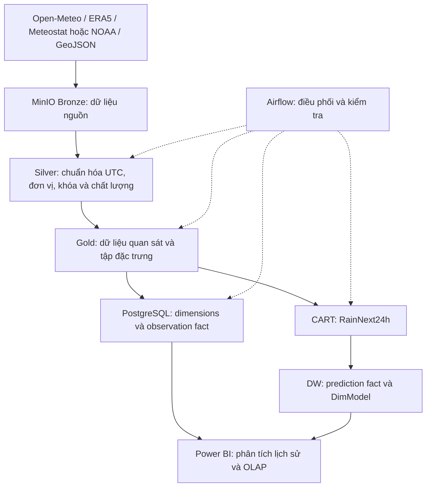

# Kho dữ liệu khí tượng đa nguồn miền Bắc Việt Nam

Dự án học phần **Kho dữ liệu và Kỹ thuật khai phá dữ liệu**, hướng tới xây dựng kho dữ liệu khí tượng đa nguồn để phân tích xu hướng và dự báo khả năng mưa tại miền Bắc Việt Nam.

Công nghệ chính: **MinIO · Apache Airflow · PostgreSQL · scikit-learn (CART) · Power BI**.

README này dùng tiếng Việt theo yêu cầu của dự án. Code và tài liệu kỹ thuật/nghiệp vụ trong `docs/` dùng tiếng Anh.

## Trạng thái hiện tại

Cập nhật ngày **2026-10-23**. Bằng chứng chi tiết (lệnh đã chạy, số dòng, thời gian chạy, hạn chế) nằm trong [nhật ký tiến độ](docs/progress.md). Đã có:

- Docker Compose cho MinIO, PostgreSQL và Airflow (đã kiểm chứng webserver, scheduler và một lần chạy DAG kiểm tra ngày 22/10); Dockerfile Airflow 2.9.3/Python 3.10 với dependency được khóa phiên bản và checksum.
- Khởi tạo bucket Bronze/Silver/Gold, DDL Star Schema và seed dimension; danh mục trạm đã xác minh trong `scripts/station_config.py`.
- ETL bằng script: Open-Meteo, Meteostat và ERA5 → Bronze → Silver → Gold → `fact_weather_observation`. Meteostat chỉ giữ giá trị quan trắc (loại giá trị mô hình dự báo). DAG `weather_bronze_to_dw_dag` (task 17) chạy trọn Bronze → Silver → Gold → DW theo năm cho Open-Meteo, Meteostat, ERA5 và mưa ngày GHCNh, có bước kiểm tra chất lượng Silver chặn trước khi ghi DW (task 24: dừng khi sai khóa, trùng, UTC, khoảng giá trị hợp lệ hoặc thiếu giờ Open-Meteo/ERA5; cảnh báo không dừng khi độ phủ, % thiếu hoặc giá trị bất thường vượt ngưỡng đã chốt ngày 22/10), rồi đối chiếu số dòng DW với Silver; đã chạy cho cả 2016–2025 (ngày 23/10, có ERA5: khớp 1.490.237 dòng giờ và 17.866 ngày mưa). DAG `weather_incremental_dag` (task 25) chạy theo lịch hằng ngày: đọc mốc watermark (năm cuối đã nạp và đối chiếu xong), chọn năm mới tiếp theo kèm chạy lại 1 năm trước để lấy dữ liệu sửa muộn, gọi DAG trên, và chỉ dời mốc khi lần chạy đó thành công; không bao giờ vượt quá năm 2025. DAG này tạm dừng khi mới tạo, phải bật tay.
- Địa giới 63 tỉnh trước sáp nhập (GeoJSON, geoBoundaries) trong Bronze kèm manifest; bản 25 tỉnh miền Bắc trong Silver, đã kiểm tra 8 điểm nằm đúng tỉnh (`scripts/ingest_boundaries.py`).
- Bronze Open-Meteo lưu nguyên bytes nhận về kèm manifest (SHA-256, độ phủ, tọa độ lưới) cho cả 80 file; ERA5 (NetCDF, Copernicus CDS): chuỗi theo giờ tại ô lưới gần nhất của 8 điểm, đủ 2016–2025, lưu nguyên bản kèm manifest (`scripts/ingest_era5_timeseries.py`), đã chuyển sang Silver (task 15, 701.376 dòng) và so sánh với Open-Meteo; ERA5 đã nạp vào DW từ 23/10 (701.376 dòng), DW tổng 1.490.237 dòng.
- Bảng Gold ML gộp nguồn (task 16, `scripts/build_ml_pivot.py`): mỗi dòng là một điểm × một giờ UTC, mỗi nguồn (Open-Meteo, ERA5, Meteostat) có cột riêng cho 8 biến, không cộng gộp giữa các nguồn. 701.376 dòng cho 2016–2025, khớp Gold và DW theo từng nguồn và năm. Mô hình CART v1 không dùng bảng này.
- Chạy lại toàn bộ trên môi trường sạch (task 34, ngày 23/10): clone repo mới, volume Docker trống, tải lại mọi nguồn rồi chạy hết pipeline (14/14 bước, khoảng 15 phút). DW, Silver và Gold khớp hoàn toàn với máy hiện tại. Lần chạy này tìm ra một lỗi và đã sửa: trên máy mới, lệnh huấn luyện mặc định có thể lưu một mô hình khác dưới tên v1. Giờ v1 được ghim mã SHA-256, và có gói phát hành mô hình (`scripts/model_release.py`) cho máy khác. Hướng dẫn: [docs/reproduce-from-scratch.md](docs/reproduce-from-scratch.md).
- Silver Open-Meteo (task 10, từ 23/10) lưu thêm tọa độ và độ cao ô lưới mà API trả về; báo lỗi nếu dữ liệu nhận về không ở múi giờ UTC (`utc_offset_seconds` khác 0). Cả 80 file đều đạt; các cột cũ không đổi.
- Bronze Meteostat (task 9, từ 23/10) lưu nguyên file `.csv.gz` nhận về kèm manifest; ghi lại cả các năm không có dữ liệu (HTTP 404) nên lần sau không hỏi lại. Vì vậy DAG chạy lại các năm đã có dữ liệu không cần Internet (đã thử 23/10 trong container không có mạng: 13/13 bước thành công).
- Gán trạm theo khoảng cách bằng GeoPandas (task 11, `scripts/assign_stations_geo.py`): tính khoảng cách trên hệ tọa độ UTM 48N, tìm trạm gần nhất trong 30 km và kiểm tra tỉnh của từng điểm. Kết quả khớp bảng trạm đang dùng và `dim_station` (chỉ đọc, không đổi DW).
- Mưa ngày tại trạm từ NOAA GHCNh (5 trạm) → bảng riêng `fact_station_daily_rain`, kèm view so sánh với Open-Meteo.
- View OLAP giờ/ngày/tháng/năm và độ phủ (`sql/02_olap_views.sql`); hướng dẫn dựng Power BI 8 trang (`docs/powerbi-dashboard-v1.md`, ngày 23/10 thêm mô tả chi tiết từng trang: biểu đồ, trường, số kiểm tra). File PBIX chưa có.
- Nhãn RainNext24h (ngưỡng 1 mm, chia train/validation/test theo năm UTC, purge biên) xuất ra Gold ML; notebook EDA `notebooks/eda_rain_next24h.ipynb` với môi trường riêng (`make notebook-setup`); bộ 22 đặc trưng không rò rỉ dữ liệu tương lai trong `gold/ml_features/` (3 file theo tập train/validation/test); mô hình CART v1 đã train, chọn tham số trên validation 2024 và đánh giá một lần trên test 2025 (F1 0,777, Recall 0,792 với nhãn đã sửa lỗi làm tròn ngày 22/10; mốc dự báo theo hiện trạng F1 0,729); hình cây và luật trong `notebooks/cart_tree_rules.ipynb`; dự đoán test 2025 đã nạp vào `fact_weather_prediction` cùng `dim_model` và view `vw_prediction_vs_actual`.
- So sánh ngưỡng và phân tích lỗi mô hình (task 36, `scripts/analyze_cart_thresholds.py`): ngưỡng chính thức 0,40 giữ nguyên; điểm ưu tiên Recall 0,36 chọn trên validation, số liệu trên test chỉ là phân tích làm sau.
- DAG chấm điểm dự báo `weather_rain_scoring_dag` (task 32): tính lại đặc trưng từ Silver cho một khoảng ngày của tập test 2025, chấm điểm bằng CART v1 đã đóng băng (kiểm tra SHA-256 với `dim_model`), ghi dự báo vào Gold rồi vào DW (dòng không đổi thì không ghi lại), sau đó đối chiếu DW với Gold. Chạy thật cả năm 2025 ngày 23/10: 69.888 dự báo, DW không thay đổi.
- Hiệu năng truy vấn DW (task 26, `scripts/benchmark_dw_queries.py`): mỗi view tối đa 1,3 giây, truy vấn đối chiếu tối đa 1,2 giây; đạt mục tiêu đã chốt (dưới 5 giây và dưới 2 giây), không cần thêm index.
- Ruff, pre-commit, Makefile, pytest và cấu hình GitHub Actions; tài liệu nghiệp vụ và đặc tả task tuần 2–5.
- Đợt rà soát ngày 22/10 đã sửa: các script ML không còn ghi đè model, nhãn hay đặc trưng đã có; tải Open-Meteo và bước Silver báo lỗi (mã thoát 1) khi thiếu file; loader DW xóa dữ liệu theo phạm vi được yêu cầu, không theo dữ liệu đến; trạm 48820 được ghi đúng là sân bay Nội Bài (cách điểm HAN 22 km); migration `05_metadata_corrections.sql` thêm `pressure_type`, vai trò và khoảng cách trạm, cùng phiên bản nhãn dùng cho chỉ số test trong `dim_model`; DAX đếm ngày mưa/nóng trong hướng dẫn Power BI trả về 0 thay vì trống. Các việc cần nhóm quyết định nằm ở [business requirements §5a](docs/business-requirements.md#5a-proposals-awaiting-team-decision-2026-10-22).

Dữ liệu thực 2016–2025 đã được dựng lại trên một máy cục bộ ngày 2026-10-21: DW có 788.861 dòng quan sát giờ (Open-Meteo 8 vị trí; Meteostat chỉ Hà Nội và không có mưa), 17.866 dòng mưa ngày GHCNh, 700.800 nhãn dùng được. Từ 23/10 DW có thêm ERA5 (8 vị trí, 701.376 dòng), tổng 1.490.237 dòng quan sát giờ. Lần kiểm tra gần nhất (23/10): `make test` 260 test đạt, `make test-integration` 22 test đạt.

**Chưa hoàn chỉnh**: dashboard Power BI (task 20, 27), trang dự báo (task 33) và đối chiếu dashboard với SQL (task 35), do bạn trong nhóm làm từ gói dữ liệu đã gửi ngày 23/10; báo cáo, slide và kịch bản demo (task 37–40). Model v1 chọn ngưỡng theo F1 (0,40 là kết quả test chính thức); điểm ưu tiên Recall 0,36 là phương án bổ sung (N3 đã duyệt 8 mục quyết định ML ngày 23/10). Nhãn và đặc trưng dựa trên dữ liệu tái phân tích, chưa phải số đo trạm. Trạng thái nghiệm thu từng task do bảng phân công quản lý, không suy ra từ việc có file.

## Tài liệu và phân công

| Tài liệu | Nội dung |
| --- | --- |
| [Đề tài gốc](<đề tài.pdf>) | Mục tiêu, phạm vi và sản phẩm của đề tài |
| [Bảng phân công](Phan_cong_cong_viec_DW_khi_tuong.xlsx) | Chủ sở hữu, lịch và trạng thái quản lý của 40 task |
| [Business requirements](docs/business-requirements.md) | Yêu cầu nghiệp vụ, luồng xử lý, tiêu chí nghiệm thu và quyết định còn mở |
| [Implementation roadmap](docs/implementation-roadmap.md) | Task ID, phụ thuộc và cách chia nhỏ công việc cho AI |
| [Architecture](docs/architecture.md) | Kiến trúc mục tiêu và thành phần hiện có |
| [Development](docs/development.md) | Setup, runtime, dependency, test và CI |
| [Data contract](docs/data-contract.md) | UTC, grain, cột, đơn vị và xử lý dữ liệu |
| [Warehouse schema](docs/warehouse-schema.md) | DDL, khóa, quan hệ, calendar và OLAP; [sơ đồ Star Schema](docs/diagrams/star-schema.md) |
| [Rain label](docs/rain-label.md) | RainNext24h, chống leakage và validation/test |
| [Naming conventions](docs/NAMING_CONVENTIONS.md) | Bucket, object key và phân vùng |
| [Task specs tuần 2–5](docs/task-specs-weeks-2-5.md) | Đặc tả nghiệp vụ các task 4, 5, 8, 9, 17, 19, 20 |
| [Power BI](docs/powerbi-dashboard-v1.md) | Hướng dẫn dựng 8 trang dashboard: mô hình, DAX, biểu đồ từng trang, số đối chiếu |
| [Reproduce from scratch](docs/reproduce-from-scratch.md) | Các lệnh dựng lại toàn bộ dự án trên máy mới (đã chạy thật ngày 23/10, task 34) |
| [Progress](docs/progress.md) | Bằng chứng đã thực hiện, kết quả kiểm tra và hạn chế |
| [AGENTS.md](AGENTS.md) | Hướng dẫn làm việc trong repository cho AI |

Đề tài gốc xác định mục tiêu; bảng phân công quản lý người phụ trách và trạng thái nhóm. Tài liệu trong `docs/` ghi hợp đồng triển khai và bằng chứng kỹ thuật. Các đề xuất chưa chốt được ghi riêng, không tự động trở thành yêu cầu đã duyệt.

## Kiến trúc mục tiêu



Đây là kiến trúc **mục tiêu**. Timestamp chuẩn là UTC có timezone; grain quan sát là **nguồn × vị trí ổn định × giờ UTC**. Dữ liệu từng nguồn được giữ riêng. Tập đặc trưng ML có thể có grain khác nhưng không làm thay đổi grain của fact quan sát.

## Setup và kiểm tra nền tảng

Cần Git, Docker Desktop/Engine với Compose v2, Python **≥ 3.10** cho công cụ cục bộ và GNU Make/bash. Trên Windows, dùng WSL2 có Docker integration. Runtime tham chiếu của ứng dụng là container Linux với **Airflow 2.9.3/Python 3.10**.

Sau khi clone và mở thư mục repository, bật Docker rồi chạy:

```bash
make setup
make hooks
make check
```

- `make setup`: tạo `.venv` và cài công cụ từ lockfile có checksum.
- `make hooks`: cài pre-commit cho checkout hiện tại.
- `make check`: kiểm tra Ruff, cấu hình Compose, test offline và integration.

Setup/build lần đầu cần mạng để tải package và image. Test offline chạy trong container với `--network none`. Integration dùng PostgreSQL/MinIO tạm, không dùng volume phát triển và tự dọn sau khi chạy. Xem [hướng dẫn phát triển](docs/development.md) để biết cách cập nhật lockfile và các giới hạn nền tảng đã kiểm tra.

## Khởi chạy stack phát triển

Nếu chưa có `.env`, sao chép `.env.example` thành `.env` và điều chỉnh cấu hình cục bộ. Giữ nguyên `.env` đã thiết lập. Sau đó chạy:

```bash
docker compose config --quiet
make build
docker compose up -d --no-build
docker compose ps
```

Lệnh `up` chạy các service khởi tạo database/bucket theo cấu hình. Bucket hoặc bảng tồn tại chưa chứng minh đã có dữ liệu thời tiết thực. PostgreSQL initializer hiện dùng tên cố định `weather_dwh`; thay `DWH_DB` riêng trong `.env` chưa đủ để hỗ trợ tên database khác.

| Dịch vụ | Địa chỉ/cổng mặc định trên máy | Tài khoản mặc định |
| --- | --- | --- |
| MinIO Console | [localhost:9001](http://localhost:9001) | `minioadmin` / `minioadmin` |
| MinIO S3 API | `http://localhost:9000` | Cùng thông tin MinIO |
| Airflow UI | [localhost:8080](http://localhost:8080) | `admin` / `admin` |
| PostgreSQL | `localhost:5434` | `postgres` / `postgres` |

PostgreSQL chứa database `airflow` cho metadata và `weather_dwh` cho DW. Bên trong Docker, endpoint là `postgres:5432` và `minio:9000`. Cổng host có thể điều chỉnh trong `.env`; PostgreSQL mặc định dùng 5434 để giảm xung đột với dịch vụ đang dùng 5432.

DAG `weather_system_healthcheck_dag` kiểm tra kết nối; DAG `open_meteo_ingest_to_bronze_dag` thu thập lịch sử khi được kích hoạt thủ công. Chạy ingestion lịch sử là một bước riêng có phạm vi tải dữ liệu cần được xác định, không phải điều kiện để kiểm tra setup.

Các hạn chế về báo lỗi của service init và ingestion được ghi trong [progress](docs/progress.md). Cần xem trạng thái/log thực tế khi khởi động; thông báo init thành công chưa đủ để kết luận mọi bước đã chạy đúng.

## Lệnh thường dùng

| Lệnh | Mục đích |
| --- | --- |
| `make help` | Liệt kê lệnh hỗ trợ |
| `make lint` | Kiểm tra Ruff lint và formatting |
| `make format` | Áp dụng lint fix và format Python |
| `make precommit` | Chạy hook trên file đã được Git theo dõi |
| `make test` | Build test image và chạy test offline |
| `make test-integration` | Chạy test với PostgreSQL/MinIO tạm |
| `make check` | Chạy lint, kiểm tra Compose và cả hai bộ test |
| `make build` | Build image runtime Airflow |
| `make up` | Build và khởi chạy stack phát triển |
| `make down` | Dừng stack, giữ volume dữ liệu |

Xem log khi cần:

```bash
docker compose logs -f minio
docker compose logs -f airflow-webserver
docker compose logs -f postgres
```

`docker compose down -v` xóa volume dữ liệu. Không dùng lệnh này để cập nhật image hoặc kiểm tra tài liệu.

## Cấu trúc repository

```text
Test_DL_weather/
├── README.md                      # Giới thiệu và setup bằng tiếng Việt
├── AGENTS.md                      # Hướng dẫn cho AI
├── .env.example                   # Cấu hình môi trường mẫu
├── .github/workflows/ci.yml        # Kiểm tra PR và push main
├── .pre-commit-config.yaml         # Ruff hooks
├── Makefile                       # Setup, kiểm tra và quản lý stack
├── pyproject.toml                 # Cấu hình Ruff/pytest
├── Dockerfile                     # Runtime và test image
├── docker-compose.yml             # Stack phát triển
├── docker-compose.test.yml        # Stack integration tạm
├── requirements.in / .txt          # Dependency runtime và lockfile
├── requirements-dev.in / .txt      # Công cụ phát triển và lockfile
├── requirements-notebook.in / .txt # Môi trường notebook EDA và lockfile
├── constraints/                   # Constraints Airflow/Python
├── .agents/skills/                # Quy trình tái sử dụng
├── docs/                          # Tài liệu bằng tiếng Anh
│   ├── business-requirements.md    # Yêu cầu nghiệp vụ
│   ├── implementation-roadmap.md   # Lộ trình 40 task
│   ├── architecture.md            # Kiến trúc
│   ├── development.md             # Môi trường và kiểm tra
│   ├── data-contract.md           # Hợp đồng dữ liệu
│   ├── warehouse-schema.md        # DW và OLAP
│   ├── rain-label.md              # Nhãn mưa và đánh giá
│   ├── NAMING_CONVENTIONS.md      # Quy ước đặt tên
│   ├── task-specs-weeks-2-5.md    # Đặc tả task tuần 2–5
│   ├── powerbi-dashboard-v1.md    # Hướng dẫn Power BI v1
│   └── progress.md                # Bằng chứng tiến độ
├── dags/                          # DAG và hướng dẫn Airflow
│   ├── weather_pipeline_health_dag.py
│   ├── dag_ingest_open_meteo.py
│   ├── dag_weather_pipeline.py    # Bronze → Silver → Gold → DW + đối chiếu (task 17)
│   ├── dag_weather_incremental.py # Cập nhật tăng dần theo watermark (task 25)
│   └── dag_rain_scoring.py        # Chấm điểm dự báo → Gold → DW + đối chiếu (task 32)
├── scripts/                       # Script và hướng dẫn ETL
│   ├── init_minio.py, seed_dimensions.py, station_config.py
│   ├── ingest_open_meteo.py, ingest_meteostat.py, ingest_ghcnh.py
│   ├── transform_*_to_silver.py   # Open-Meteo, Meteostat, GHCNh → Silver
│   ├── load_gold_observations.py, load_station_daily_rain.py
│   ├── quality_checks.py
│   ├── quality_gate.py            # Kiểm tra chất lượng Silver trước khi nạp DW (task 24)
│   ├── build_ml_pivot.py          # Bảng Gold ML gộp nguồn theo giờ (task 16)
│   ├── model_release.py           # Xuất/nhập gói phát hành mô hình CART v1 (task 34)
│   ├── rain_labels.py, export_rain_labels.py, rain_eda.py, build_rain_features.py, train_cart.py, evaluate_cart_test.py, rescore_cart_corrected_labels.py, cart_rules.py
│   ├── ingest_boundaries.py       # Địa giới GeoJSON → Bronze/Silver
│   ├── ingest_era5.py             # ERA5 NetCDF theo vùng, theo tháng (CDS) → Bronze
│   ├── ingest_era5_timeseries.py  # ERA5 chuỗi theo điểm (CDS) → Bronze
│   ├── transform_era5_to_silver.py, compare_era5_open_meteo.py  # ERA5 → Silver, so sánh với Open-Meteo
│   ├── assign_stations_geo.py     # Khoảng cách và gán trạm bằng GeoPandas (task 11)
│   ├── reconcile_dw.py            # Đối chiếu DW với Silver
│   ├── pipeline_watermark.py      # Mốc watermark của DAG tăng dần (task 25)
│   ├── analyze_cart_thresholds.py # So sánh ngưỡng, phân tích lỗi (task 36)
│   ├── benchmark_dw_queries.py    # Đo thời gian truy vấn DW (task 26)
│   ├── score_cart.py, publish_predictions.py  # Chấm điểm dự báo, đăng lên DW (task 32)
│   └── load_predictions.py        # Đăng ký model và dự đoán test vào DW (task 31)
├── sql/                           # Khởi tạo DW và hướng dẫn SQL
│   ├── 01_init_postgres.sh
│   ├── init_dwh_schema.sql
│   ├── 02_olap_views.sql
│   ├── 03_station_daily_rain.sql
│   ├── 04_predictions.sql
│   └── 05_metadata_corrections.sql
├── notebooks/                     # Notebook EDA, cây và luật CART
├── tests/                         # Test offline/integration và fixture
├── plugins/                       # Thư mục plugin Airflow
├── config/                        # Cấu hình Airflow bổ sung
└── data/                          # Dữ liệu cục bộ, được gitignore
```

Đề tài PDF và bảng phân công Excel nằm tại thư mục gốc, được liên kết trong mục tài liệu ở trên. `.env` là cấu hình cục bộ, không đưa vào Git.

## Cách tiếp tục triển khai cùng AI

1. Đọc [business requirements](docs/business-requirements.md), [roadmap](docs/implementation-roadmap.md) và [progress](docs/progress.md).
2. Chọn task ID trong bảng phân công và xác định một phần việc nhỏ, dữ liệu/phạm vi chạy và tiêu chí nghiệm thu.
3. Đọc hướng dẫn scoped và tài liệu hợp đồng liên quan trước khi sửa code. Chốt các quyết định còn mở nếu chúng ảnh hưởng trực tiếp tới phần việc.
4. Triển khai, chạy kiểm tra phù hợp rồi cập nhật `docs/progress.md` ngay trong lượt làm việc đó, kể cả kết quả chưa hoàn tất hoặc kiểm tra thất bại.

Ghi rõ file thay đổi, lệnh thực sự đã chạy, runtime, dữ liệu giả lập hay thực, phạm vi thời gian và hạn chế còn lại. Chủ sở hữu/trạng thái task vẫn quản lý trong workbook. Skills mô tả quy trình; tài liệu domain xác định hợp đồng của dự án.

Cấu hình CI dùng cùng Makefile như kiểm tra cục bộ. Chỉ kết luận GitHub Actions đạt sau khi xem một lần chạy thực tế; file workflow và test cục bộ không thay thế bằng chứng từ GitHub runner.
