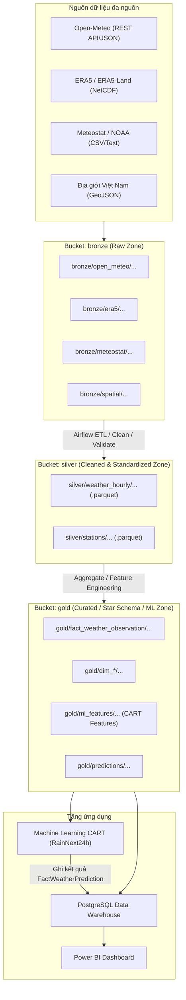

# QUY ƯỚC ĐẶT TÊN BUCKET VÀ FILE TRÊN MINIO DATA LAKE

> **Dự án**: Xây dựng kho dữ liệu khí tượng đa nguồn phục vụ phân tích xu hướng và dự báo khả năng mưa tại miền Bắc Việt Nam  
> **Môn học**: Kho dữ liệu và Kỹ thuật khai phá dữ liệu  
> **Kiến trúc lưu trữ**: Data Lake Medallion Architecture (MinIO) kết hợp PostgreSQL Data Warehouse (Star Schema)

---

## 1. TỔNG QUAN KIẾN TRÚC MEDALLION TRÊN MINIO

Hệ thống Data Lake được tổ chức thành 3 tầng bucket chính trên MinIO:



---

## 2. QUY TẮC ĐẶT TÊN CHUNG (GENERAL CONVENTIONS)

Tài liệu này quản lý đường dẫn. Định nghĩa cột/đơn vị nằm trong [data contract](data-contract.md); grain/khóa nằm trong [warehouse schema](warehouse-schema.md); nhãn nằm trong [rain label](rain-label.md). Tọa độ/trạm bên dưới là tham chiếu ban đầu, chưa chứng minh đã xác minh metadata trạm hoặc địa giới hiện tại.

Đường dẫn `bronze/open_meteo/...` gồm bucket `bronze` và object key `open_meteo/...`. Truyền riêng hai giá trị cho MinIO; không thêm tên bucket vào key lần nữa.

1. **Ký tự sử dụng**:
   - Prefix và tên biến dùng chữ thường (`a-z`), số, gạch dưới và gạch nối. Mã địa điểm giữ chữ hoa hiện có (`HAN`, `PTO`, ...). Dấu `/`, `=`, `.` dùng cho đường dẫn, partition và phần mở rộng theo mẫu.
   - Tuyệt đối không dùng khoảng trắng (space) và ký tự tiếng Việt có dấu.
2. **Quy tắc phân vùng (Partitioning Pattern)**:
   - Áp dụng chuẩn phân vùng kiểu Hive: `year=YYYY/month=MM/` (hoặc `day=DD` nếu dữ liệu lớn).
   - Tối ưu hóa việc lọc dữ liệu theo thời gian (partition pruning) cho Apache Airflow và các engine như DuckDB, Pandas, PyArrow.
3. **Quy ước thời gian (Timestamp)**:
   - Tên file sử dụng format `YYYYMMDD` (ngày) hoặc `YYYYMM` (tháng).
   - Nội dung lưu chuẩn UTC có timezone; có thể thêm `timestamp_local` suy ra theo `Asia/Ho_Chi_Minh` UTC+07:00. Giờ local không thay UTC canonical.
4. **Mã địa điểm chuẩn (Location Code)**:
   - Sử dụng mã 3 ký tự chuẩn đại diện cho các tỉnh/thành phố miền Bắc:
     * `HAN`: Hà Nội (Trạm Láng)
     * `PTO`: Phú Thọ
     * `TNG`: Thái Nguyên
     * `TUQ`: Tuyên Quang
     * `LCA`: Lào Cai
     * `HBI`: Hòa Bình
     * `HPH`: Hải Phòng
     * `NBI`: Ninh Bình

---

## 3. CHI TIẾT TẦNG BRONZE (RAW ZONE)

### 3.1. Mục đích
- Lưu trữ dữ liệu thô **nguyên bản 100%** từ các nguồn thu thập (Open-Meteo, ERA5, Meteostat, GeoJSON).
- Không chỉnh sửa nội dung, không loại bỏ trường dữ liệu, không đổi định dạng.
- Đảm bảo khả năng tái tạo (reproducibility) toàn bộ quy trình khi cần chạy lại pipeline.

Đây là mục tiêu bảo toàn raw payload. Script Open-Meteo hiện thêm `_pipeline_metadata` vào JSON và serialize lại, chưa đáp ứng nguyên bản 100%. Metadata cần tách riêng khi sửa ingestion; xem [tiến độ](progress.md).

### 3.2. Cấu trúc đường dẫn tổng quát
```
bronze/<source_name>/<data_type>/year=YYYY/month=MM/<source_name>_<location_or_region>_<datatype>_<time_range>.<ext>
```

Mẫu theo tháng dùng cho request theo tháng. Ingestion Open-Meteo hiện tải theo năm, hỗ trợ key thực tế `open_meteo/hourly/year=YYYY/open_meteo_<LOCATION>_hourly_<YYYY>0101_<YYYY>1231.json` trong bucket Bronze. Không di chuyển object hiện có chỉ để khớp ví dụ tháng; producer/consumer phải thống nhất window và key.

### 3.3. Quy ước theo từng nguồn dữ liệu

| Nguồn | Định dạng | Cấu trúc đường dẫn (Object Path) | Ví dụ cụ thể |
|---|---|---|---|
| **Open-Meteo** | `.json` | `open_meteo/hourly/year=YYYY/month=MM/open_meteo_<location>_hourly_<start_date>_<end_date>.json` | `bronze/open_meteo/hourly/year=2024/month=05/open_meteo_HAN_hourly_20240501_20240531.json` |
| **ERA5 / ERA5-Land** | `.nc` | `era5/reanalysis/year=YYYY/month=MM/era5_north_vietnam_hourly_<YYYYMM>.nc` | `bronze/era5/reanalysis/year=2024/month=05/era5_north_vietnam_hourly_202405.nc` |
| **Meteostat** | `.csv` | `meteostat/station_hourly/year=YYYY/meteostat_station_<station_id>_hourly_<YYYY>.csv` | `bronze/meteostat/station_hourly/year=2024/meteostat_station_48820_hourly_2024.csv` |
| **NOAA** | `.csv` / `.txt` | `noaa/station_hourly/year=YYYY/noaa_station_<station_id>_hourly_<YYYY>.csv` | `bronze/noaa/station_hourly/year=2024/noaa_station_488200_hourly_2024.csv` |
| **Bản đồ địa giới** | `.geojson` | `spatial/boundaries/<name>_<version>.geojson` | `bronze/spatial/boundaries/vietnam_northern_provinces_v1.geojson` |

---

## 4. CHI TIẾT TẦNG SILVER (CLEANED & STANDARDIZED ZONE)

### 4.1. Mục đích
- Làm sạch dữ liệu: xử lý giá trị ngoại lai (outliers), xử lý khuyết thiếu (missing values).
- Chuẩn hóa:
  * Múi giờ: Thống nhất `timestamp_utc` và `timestamp_local` (UTC+7).
  * Tên cột: Sử dụng `snake_case` chuẩn hóa (`temperature_c`, `humidity_percent`, `precipitation_mm`, `pressure_hpa`, `wind_speed_ms`).
  * Đơn vị đo: Nhiệt độ (°C), Áp suất (hPa), Lượng mưa (mm), Gió (m/s).
- Định dạng lưu trữ: **Apache Parquet** nén `Snappy` (hiệu năng cao, tiết kiệm dung lượng, đọc theo cột tối ưu cho phân tích).

### 4.2. Cấu trúc đường dẫn và ví dụ
```
silver/weather_hourly/year=YYYY/month=MM/weather_hourly_<location>_<YYYYMM>.parquet
```

Mẫu trên dùng cho file gộp nguồn hoặc mẫu thử, giữ `source_name` trên mọi dòng. Nếu xuất file riêng nguồn, đề xuất key `weather_hourly/source=<source>/year=YYYY/month=MM/weather_hourly_<LOCATION>_<YYYYMM>.parquet` để tránh ghi đè. ETL Silver thực chưa triển khai; chốt strategy và cập nhật producer/consumer trước dùng mẫu mới.

- **Ví dụ**:
  * Dữ liệu thời tiết theo giờ Hà Nội:  
    `silver/weather_hourly/year=2024/month=05/weather_hourly_HAN_202405.parquet`
  * Dữ liệu thời tiết theo giờ Lào Cai:  
    `silver/weather_hourly/year=2024/month=05/weather_hourly_LCA_202405.parquet`
  * Dữ liệu trạm đo đã chuẩn hóa:  
    `silver/stations/stations_metadata_cleaned.parquet`
  * Báo cáo chất lượng dữ liệu (Data Quality Reports):  
    `silver/quality_reports/dq_report_20240501.json`

---

## 5. CHI TIẾT TẦNG GOLD (CURATED / WAREHOUSE STAGING & ML ZONE)

### 5.1. Mục đích
- Tổng hợp đa chiều và ánh xạ trực tiếp sang các bảng **Star Schema** của PostgreSQL Data Warehouse:
  * Fact: `fact_weather_observation`
  * Dimensions: `dim_date`, `dim_time`, `dim_location`, `dim_source`, `dim_station`
- Tạo bộ thuộc tính (Feature Store) phục vụ bài toán Khai phá dữ liệu với thuật toán Cây quyết định CART:
  * Nhãn: `RainNext24h` (0 / 1 hoặc No / Yes).
  * Đặc trưng: Trễ nhiệt độ, trễ áp suất, tổng lượng mưa 3h/6h/12h trước, biến đổi theo mùa.
- Lưu trữ kết quả dự báo: `fact_weather_prediction`.

### 5.2. Cấu trúc đường dẫn và ví dụ

| Nhóm dữ liệu | Cấu trúc đường dẫn | Ví dụ |
|---|---|---|
| **Fact Observation** | `fact_weather_observation/year=YYYY/month=MM/fact_weather_observation_<YYYYMM>.parquet` | `gold/fact_weather_observation/year=2024/month=05/fact_weather_observation_202405.parquet` |
| **Dim Date** | `dim_date/dim_date.parquet` | `gold/dim_date/dim_date.parquet` |
| **Dim Location** | `dim_location/dim_location.parquet` | `gold/dim_location/dim_location.parquet` |
| **Dim Source** | `dim_source/dim_source.parquet` | `gold/dim_source/dim_source.parquet` |
| **Dim Station** | `dim_station/dim_station.parquet` | `gold/dim_station/dim_station.parquet` |
| **ML Dataset (CART)** | `ml_features/cart_rain_prediction_<split>_<version>.parquet` | `gold/ml_features/cart_rain_train_2016_2023_v1.parquet`<br>`gold/ml_features/cart_rain_val_2024_v1.parquet`<br>`gold/ml_features/cart_rain_test_2025_v1.parquet` |
| **Dự báo mô hình** | `predictions/year=YYYY/month=MM/rain_predictions_cart_<YYYYMMDD>.parquet` | `gold/predictions/year=2024/month=05/rain_predictions_cart_20240501.parquet` |

---

## 6. DANH MỤC ĐỊA ĐIỂM NGHIÊN CỨU MIỀN BẮC (LOCATION REFERENCE TABLE)

| Mã địa điểm (`location_code`) | Tên địa phương | Vĩ độ (`latitude`) | Kinh độ (`longitude`) | Độ cao ước tính (`elevation_m`) | Mã trạm WMO tham chiếu |
|:---:|---|:---:|:---:|:---:|:---:|
| **HAN** | Hà Nội | 21.0285 | 105.8542 | 10 m | 48820 (Láng) |
| **PTO** | Phú Thọ | 21.3986 | 105.2280 | 25 m | 48825 (Việt Trì) |
| **TNG** | Thái Nguyên | 21.5942 | 105.8482 | 35 m | 48826 |
| **TUQ** | Tuyên Quang | 21.8236 | 105.2153 | 50 m | 48816 |
| **LCA** | Lào Cai | 22.4856 | 103.9707 | 80 m | 48803 |
| **HBI** | Hòa Bình | 20.8172 | 105.3376 | 20 m | 48830 |
| **HPH** | Hải Phòng | 20.8449 | 106.6881 | 4 m | 48838 (Phù Liễn) |
| **NBI** | Ninh Bình | 20.2506 | 105.9745 | 5 m | 48840 |

---

## 7. BẢNG ÁNH XẠ THUỘC TÍNH VÀ ĐƠN VỊ ĐO CHUẨN HÓA

Mapping dưới đây là định hướng ban đầu, không là phép đổi đơn vị áp dụng mù quáng. Đọc metadata từng sản phẩm: phân biệt surface/sea-level pressure; xác định loại radiation, interval và accumulation trước khi đổi W/m². Kiểu PostgreSQL chính thức xem DDL/schema; kiểu trao đổi Silver xem data contract.

| Tên trường thô (Raw Names) | Tên trường chuẩn hóa (Silver/Gold) | Đơn vị đo | Kiểu dữ liệu | Ý nghĩa |
|---|---|:---:|:---:|---|
| `temperature_2m`, `temp`, `t2m` | `temperature_c` | °C | `FLOAT` / `NUMERIC(5,2)` | Nhiệt độ không khí |
| `relative_humidity_2m`, `rhum`, `r` | `humidity_percent` | % | `FLOAT` / `NUMERIC(5,2)` | Độ ẩm tương đối |
| `surface_pressure`, `pres`, `sp` | `pressure_hpa` | hPa | `FLOAT` / `NUMERIC(7,2)` | Áp suất khí quyển |
| `precipitation`, `prcp`, `tp` | `precipitation_mm` | mm | `FLOAT` / `NUMERIC(6,2)` | Lượng mưa theo giờ |
| `wind_speed_10m`, `wspd`, `si10` | `wind_speed_ms` | m/s | `FLOAT` / `NUMERIC(5,2)` | Tốc độ gió tại 10m |
| `wind_direction_10m`, `wdir` | `wind_direction_deg` | độ (0-360) | `INT` / `NUMERIC(5,2)` | Hướng gió |
| `cloud_cover`, `tcc` | `cloud_cover_percent` | % | `FLOAT` / `NUMERIC(5,2)` | Độ che phủ mây |
| `surface_solar_radiation_downwards` | `solar_radiation_wm2` | W/m² | `FLOAT` / `NUMERIC(7,2)` | Bức xạ mặt trời |
