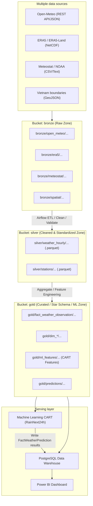

# MinIO Data Lake Bucket and File Naming Conventions

> **Project**: Multi-source weather warehouse for trend analysis and rain prediction in northern Vietnam
> **Course**: Data Warehousing and Data Mining
> **Storage architecture**: MinIO Medallion Data Lake with a PostgreSQL Star Schema warehouse

---

## 1. MinIO Medallion Architecture

The Data Lake has three primary bucket layers in MinIO:



---

## 2. General Conventions

This document owns paths. Columns/units belong to the [data contract](data-contract.md); grain/keys to [warehouse schema](warehouse-schema.md); labels to [rain label](rain-label.md). Station identities in §6 were verified on 2026-10-21 (Nội Bài identity of 48820 on 2026-10-22); research point coordinates are references, not boundaries.

Path `bronze/open_meteo/...` consists of bucket `bronze` and object key `open_meteo/...`. Pass these separately to MinIO; do not repeat the bucket name inside the key.

1. **Characters**:
   - Prefixes/variable names use lowercase (`a-z`), digits, underscores, and hyphens. Preserve uppercase location codes (`HAN`, `PTO`, ...). Use `/`, `=`, `.` for paths, partitions, and extensions as shown.
   - Do not use spaces or accented Vietnamese characters in object paths.
2. **Partitioning pattern**:
   - Use Hive-style partitions: `year=YYYY/month=MM/` (or `day=DD` for larger datasets).
   - Support time filtering and partition pruning for Apache Airflow and engines such as DuckDB, Pandas, and PyArrow.
3. **Timestamp conventions**:
   - Filenames use `YYYYMMDD` for days or `YYYYMM` for months.
   - Store timezone-aware UTC. Optionally add `timestamp_local` derived using `Asia/Ho_Chi_Minh` UTC+07:00; local time does not replace canonical UTC.
4. **Stable location codes**:
   - Use the established three-character codes for northern Vietnam research locations:
     * `HAN`: Hà Nội (Lang station)
     * `PTO`: Phú Thọ
     * `TNG`: Thái Nguyên
     * `TUQ`: Tuyên Quang
     * `LCA`: Lào Cai
     * `HBI`: Hòa Bình
     * `HPH`: Hải Phòng
     * `NBI`: Ninh Bình

---

## 3. Bronze Layer (Raw Zone)

### 3.1. Purpose
- Store **unaltered original** raw data from Open-Meteo, ERA5, Meteostat, and GeoJSON sources.
- Do not modify content, remove fields, or change formats.
- Preserve reproducibility when rerunning the pipeline.

This is the raw-preservation target. Open-Meteo, GHCNh, ERA5, and boundary ingestion meet it, with separate manifests (Open-Meteo since 2026-10-22; before that it added `_pipeline_metadata` and reserialized the JSON). Meteostat ingestion stores the decompressed CSV without a manifest and does not meet it yet; see [progress](progress.md).

### 3.2. General Path Structure
```
bronze/<source_name>/<data_type>/year=YYYY/month=MM/<source_name>_<location_or_region>_<datatype>_<time_range>.<ext>
```

Monthly examples apply to monthly requests. Current Open-Meteo ingestion downloads annually and uses key `open_meteo/hourly/year=YYYY/open_meteo_<LOCATION>_hourly_<YYYY>0101_<YYYY>1231.json` in Bronze. Do not move existing objects solely to match monthly examples; producers/consumers must agree on windows and keys. Since 2026-10-22 each object holds the response bytes unchanged, and its manifest is `open_meteo/manifests/year=YYYY/open_meteo_<LOCATION>_hourly_<YYYY>0101_<YYYY>1231.json` (request, retrieval time, SHA-256, coverage, response grid coordinates and time zone).

### 3.3. Source-specific Conventions

| Source | Format | Object path structure | Example |
|---|---|---|---|
| **Open-Meteo** | `.json` | `open_meteo/hourly/year=YYYY/month=MM/open_meteo_<location>_hourly_<start_date>_<end_date>.json` | `bronze/open_meteo/hourly/year=2024/month=05/open_meteo_HAN_hourly_20240501_20240531.json` |
| **ERA5 point time series** (implemented 2026-10-23; 8 locations × 2016–2025) | `.zip` of one NetCDF as received, + `.json` manifest | `era5/timeseries/location=<LOCATION>/era5_timeseries_<LOCATION>_<YYYYMMDD>_<YYYYMMDD>.zip`; manifest `era5/manifests/timeseries/location=<LOCATION>/era5_timeseries_<LOCATION>_<YYYYMMDD>_<YYYYMMDD>.json` | `bronze/era5/timeseries/location=HAN/era5_timeseries_HAN_20160101_20251231.zip` |
| **ERA5** gridded (implemented; monthly; 4 months stored, stopped 2026-10-23) | `.nc`, or `.zip` of NetCDF files as received, + `.json` manifest | `era5/reanalysis/year=YYYY/month=MM/era5_north_vietnam_hourly_<YYYYMM>.<nc\|zip>`; manifest `era5/manifests/year=YYYY/month=MM/era5_north_vietnam_hourly_<YYYYMM>.json` (names the object key and lists the NetCDF members). The CDS returns a zip because NetCDF output splits instantaneous and accumulated variables into two files | `bronze/era5/reanalysis/year=2024/month=05/era5_north_vietnam_hourly_202405.nc` |
| **Meteostat** | `.csv` | `meteostat/station_hourly/year=YYYY/meteostat_station_<station_id>_hourly_<YYYY>.csv` (the downloaded `.csv.gz` is stored decompressed, without a manifest or checksum; a known gap) | `bronze/meteostat/station_hourly/year=2024/meteostat_station_48820_hourly_2024.csv` |
| **NOAA ISD** (not used; superseded by GHCNh) | `.csv` / `.txt` | `noaa/station_hourly/year=YYYY/noaa_station_<station_id>_hourly_<YYYY>.csv` | `bronze/noaa/station_hourly/year=2024/noaa_station_488200_hourly_2024.csv` |
| **NOAA GHCNh** (implemented) | `.psv` + `.json` manifest | `ghcnh/station_hourly/year=YYYY/GHCNh_VMM000<wmo>_<YYYY>.psv`; manifest `ghcnh/manifests/year=YYYY/GHCNh_VMM000<wmo>_<YYYY>.json` | `bronze/ghcnh/station_hourly/year=2024/GHCNh_VMM00048826_2024.psv` |
| **Boundary maps** (implemented) | `.geojson` + `.json` manifest | `spatial/boundaries/<name>_<version>.geojson`; manifest `spatial/manifests/<name>_<version>.json` | `bronze/spatial/boundaries/vnm_adm1_pre2025_geoboundaries_9469f09.geojson` (version = source release commit) |

---

## 4. Silver Layer (Cleaned and Standardized Zone)

### 4.1. Purpose
- Clean data under agreed outlier and missing-value handling policies.
- Normalize:
  * Time: consistently use `timestamp_utc` and derived `timestamp_local` (UTC+7).
  * Columns: standard `snake_case` names (`temperature_c`, `humidity_percent`, `precipitation_mm`, `pressure_hpa`, `wind_speed_ms`).
  * Units: temperature (°C), pressure (hPa), precipitation (mm), wind speed (m/s).
- Storage: **Apache Parquet** with `Snappy` compression for efficient storage and analytical column reads.

### 4.2. Paths and Examples
```
silver/weather_hourly/year=YYYY/month=MM/weather_hourly_<location>_<YYYYMM>.parquet
```

The pattern above is the Open-Meteo Silver key (one file per location-month, `source_name` on every row). Implemented keys for the other sources:

| Source | Silver key |
| --- | --- |
| Meteostat (hourly) | `weather_hourly/year=YYYY/month=MM/weather_hourly_meteostat_<station_id>_<YYYYMM>.parquet` (same prefix as Open-Meteo; the Gold loader reads both) |
| Province boundaries | `spatial/boundaries/northern_provinces_pre2025_<version>.geojson` (25 northern provinces, version `v1`) and the check report `spatial/boundaries/northern_provinces_pre2025_<version>.json` |
| ERA5 (hourly, nearest grid cell) | `era5/weather_hourly/year=YYYY/month=MM/era5_hourly_<LOCATION>_<YYYYMM>.parquet` (outside `weather_hourly/`; the Gold loader, quality gate, and reconciliation read both prefixes since 2026-10-23); comparison reports `quality_reports/compare_era5_open_meteo_<start>_<end>_<YYYYMMDDTHHMMSSZ>.json` |
| GHCNh (daily rain) | `ghcnh/station_daily_rain/year=YYYY/ghcnh_daily_rain_<wmo>_<YYYY>.parquet`; rejected rows `ghcnh/quarantine/year=YYYY/ghcnh_daily_rain_<wmo>_<YYYY>_quarantine.parquet` |

The key `weather_hourly/source=<source>/...` proposed earlier was not adopted.

- **Examples**:
  * Hourly Hanoi weather:
    `silver/weather_hourly/year=2024/month=05/weather_hourly_HAN_202405.parquet`
  * Hourly Lao Cai weather:
    `silver/weather_hourly/year=2024/month=05/weather_hourly_LCA_202405.parquet`
  * Normalized station metadata:
    `silver/stations/stations_metadata_cleaned.parquet`
  * Data quality reports:
    `silver/quality_reports/dq_report_20240501.json`
  * DW reconciliation reports (ID 17): `gold/quality_reports/reconcile_<start>_<end>[_<LOCATION>]_<YYYYMMDDTHHMMSSZ>.json`
  * Silver quality-gate reports (ID 24): `silver/quality_reports/quality_gate_<start>_<end>[_<LOCATION>]_<YYYYMMDDTHHMMSSZ>.json`

---

## 5. Gold Layer (Curated / Warehouse Staging and ML Zone)

### 5.1. Purpose
- Prepare multidimensional products mapped to PostgreSQL **Star Schema** tables:
  * Fact: `fact_weather_observation`
  * Dimensions: `dim_date`, `dim_time`, `dim_location`, `dim_source`, `dim_station`
- Build feature datasets for CART classification:
  * Label: `RainNext24h` (0 / 1 or No / Yes).
  * Features: temperature/pressure lags, preceding 3h/6h/12h rainfall totals, and seasonal variation. The implemented v1 feature list is in `docs/rain-label.md`.
- Store predictions: `fact_weather_prediction`.

### 5.2. Paths and Examples

| Data group | Path structure | Example |
|---|---|---|
| **Fact Observation** | `fact_weather_observation/year=YYYY/month=MM/fact_weather_observation_<YYYYMM>.parquet` | `gold/fact_weather_observation/year=2024/month=05/fact_weather_observation_202405.parquet` |
| **Dim Date** | `dim_date/dim_date.parquet` | `gold/dim_date/dim_date.parquet` |
| **Dim Location** | `dim_location/dim_location.parquet` | `gold/dim_location/dim_location.parquet` |
| **Dim Source** | `dim_source/dim_source.parquet` | `gold/dim_source/dim_source.parquet` |
| **Dim Station** | `dim_station/dim_station.parquet` | `gold/dim_station/dim_station.parquet` |
| **ML labels (implemented)** | `ml_labels/rain_next24h_labels_<version>.parquet` + `.json` manifest | `gold/ml_labels/rain_next24h_labels_v2.parquet` (current, labels `rain_next24h_v0.2.1`); `_v1` kept for model v1 |
| **ML Dataset (CART, implemented)** | `ml_features/cart_rain_<split tag>_<version>.parquet` (split tags `train_2016_2023`, `val_2024`, `test_2025`) + `ml_features/cart_rain_features_<version>.json` manifest | `gold/ml_features/cart_rain_train_2016_2023_v2.parquet`<br>`gold/ml_features/cart_rain_val_2024_v2.parquet`<br>`gold/ml_features/cart_rain_test_2025_v2.parquet` (current; `_v1` kept for model v1) |
| **CART model (implemented)** | `ml_models/cart_rain_next24h_<version>/model.joblib` + `report.json`; after the one-time test evaluation also `test_evaluation.json` + `test_predictions.parquet`, and `test_evaluation_corrected_labels.json` after the 2026-10-22 label fix | `gold/ml_models/cart_rain_next24h_v1/model.joblib` |
| **Pipeline state** (ID 25, implemented 2026-10-23) | `pipeline_state/weather_bronze_to_dw_watermark.json` | `gold/pipeline_state/weather_bronze_to_dw_watermark.json`: last UTC year committed and reconciled by `weather_bronze_to_dw_dag`, the window and run that advanced it |
| **Model predictions** (implemented 2026-10-23 by the ID 32 scoring DAG; one object per UTC origin day) | `predictions/year=YYYY/month=MM/rain_predictions_cart_<YYYYMMDD>.parquet`; reports `quality_reports/scoring_cart_<version>_<start>_<end>_<YYYYMMDDTHHMMSSZ>.json` and `quality_reports/prediction_reconcile_<version>_<start>_<end>_<YYYYMMDDTHHMMSSZ>.json` | `gold/predictions/year=2025/month=05/rain_predictions_cart_20250501.parquet`. The one-time test evaluation output of CART v1 stays in `ml_models/cart_rain_next24h_v1/test_predictions.parquet` |

---

## 6. Northern Vietnam Research Location References

Latitude/longitude/elevation are the research point used for gridded sources. Reference stations were verified on 2026-10-21 against Meteostat station metadata and the NOAA ISD station history; station coordinates live in `scripts/station_config.py`. The earlier version of this table assigned 48825 (Hà Đông), 48826 (Phù Liễn), 48830 (Lạng Sơn), 48838 (Móng Cái), and 48840 (Thanh Hóa) to the wrong locations; 48816 could not be verified.

| Location code (`location_code`) | Location name | Latitude (`latitude`) | Longitude (`longitude`) | Estimated elevation (`elevation_m`) | Reference WMO station (verified) |
|:---:|---|:---:|:---:|:---:|:---:|
| **HAN** | Hà Nội | 21.0285 | 105.8542 | 10 m | 48820: Meteostat "Ha Noi", observations from Nội Bài airport (ISD 488200, METAR VVNB), 22.0 km away, role `nearest_available` |
| **PTO** | Phú Thọ | 21.3986 | 105.2280 | 25 m | None verified |
| **TNG** | Thái Nguyên | 21.5942 | 105.8482 | 35 m | 48831 (not served by Meteostat) |
| **TUQ** | Tuyên Quang | 21.8236 | 105.2153 | 50 m | None verified |
| **LCA** | Lào Cai | 22.4856 | 103.9707 | 80 m | 48803 (not served by Meteostat) |
| **HBI** | Hòa Bình | 20.8172 | 105.3376 | 20 m | None verified |
| **HPH** | Hải Phòng | 20.8449 | 106.6881 | 4 m | 48826 (Phù Liễn) |
| **NBI** | Ninh Bình | 20.2506 | 105.9745 | 5 m | None verified |

---

## 7. Standard Attribute and Unit Mapping

These mappings are initial guidance, not unconditional conversions. Read product metadata: distinguish surface/sea-level pressure and establish radiation type, interval, and accumulation before conversion to W/m². Official PostgreSQL types are in DDL/schema; Silver exchange types are in the data contract.

| Raw names | Standard name (Silver/Gold) | Unit | Data type | Meaning |
|---|---|:---:|:---:|---|
| `temperature_2m`, `temp`, `t2m` | `temperature_c` | °C | `FLOAT` / `NUMERIC(5,2)` | Air temperature |
| `relative_humidity_2m`, `rhum`, `r` | `humidity_percent` | % | `FLOAT` / `NUMERIC(5,2)` | Relative humidity |
| `surface_pressure`, `pres`, `sp` | `pressure_hpa` | hPa | `FLOAT` / `NUMERIC(7,2)` | Atmospheric pressure |
| `precipitation`, `prcp`, `tp` | `precipitation_mm` | mm | `FLOAT` / `NUMERIC(6,2)` | Hourly precipitation |
| `wind_speed_10m`, `wspd`, `si10` | `wind_speed_ms` | m/s | `FLOAT` / `NUMERIC(5,2)` | Wind speed at 10 m |
| `wind_direction_10m`, `wdir` | `wind_direction_deg` | degrees (0–360) | `INT` / `NUMERIC(5,2)` | Wind direction |
| `cloud_cover`, `tcc` | `cloud_cover_percent` | % | `FLOAT` / `NUMERIC(5,2)` | Cloud cover |
| `surface_solar_radiation_downwards` | `solar_radiation_wm2` | W/m² | `FLOAT` / `NUMERIC(7,2)` | Solar radiation |
