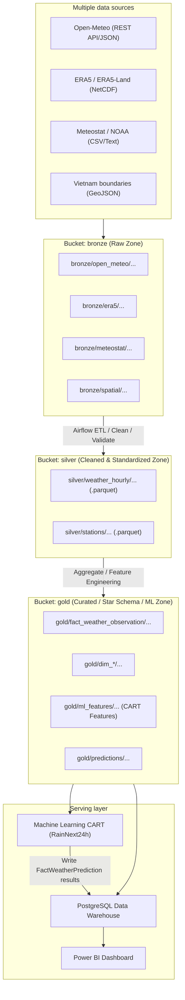

# MinIO Data Lake Bucket and File Naming Conventions

> **Project**: Multi-source weather warehouse for trend analysis and rain prediction in northern Vietnam
> **Course**: Data Warehousing and Data Mining
> **Storage architecture**: MinIO Medallion Data Lake with a PostgreSQL Star Schema warehouse

---

## 1. MinIO Medallion Architecture

The Data Lake has three primary bucket layers in MinIO:



---

## 2. General Conventions

This document owns paths. Columns/units belong to the [data contract](data-contract.md); grain/keys to [warehouse schema](warehouse-schema.md); labels to [rain label](rain-label.md). Coordinates/stations below are initial references, not evidence of verified station metadata or current boundaries.

Path `bronze/open_meteo/...` consists of bucket `bronze` and object key `open_meteo/...`. Pass these separately to MinIO; do not repeat the bucket name inside the key.

1. **Characters**:
   - Prefixes/variable names use lowercase (`a-z`), digits, underscores, and hyphens. Preserve uppercase location codes (`HAN`, `PTO`, ...). Use `/`, `=`, `.` for paths, partitions, and extensions as shown.
   - Do not use spaces or accented Vietnamese characters in object paths.
2. **Partitioning pattern**:
   - Use Hive-style partitions: `year=YYYY/month=MM/` (or `day=DD` for larger datasets).
   - Support time filtering and partition pruning for Apache Airflow and engines such as DuckDB, Pandas, and PyArrow.
3. **Timestamp conventions**:
   - Filenames use `YYYYMMDD` for days or `YYYYMM` for months.
   - Store timezone-aware UTC. Optionally add `timestamp_local` derived using `Asia/Ho_Chi_Minh` UTC+07:00; local time does not replace canonical UTC.
4. **Stable location codes**:
   - Use the established three-character codes for northern Vietnam research locations:
     * `HAN`: Hà Nội (Lang station)
     * `PTO`: Phú Thọ
     * `TNG`: Thái Nguyên
     * `TUQ`: Tuyên Quang
     * `LCA`: Lào Cai
     * `HBI`: Hòa Bình
     * `HPH`: Hải Phòng
     * `NBI`: Ninh Bình

---

## 3. Bronze Layer (Raw Zone)

### 3.1. Purpose
- Store **unaltered original** raw data from Open-Meteo, ERA5, Meteostat, and GeoJSON sources.
- Do not modify content, remove fields, or change formats.
- Preserve reproducibility when rerunning the pipeline.

This is the raw-preservation target. Current Open-Meteo ingestion adds `_pipeline_metadata` and reserializes JSON, so it does not meet that target. Separate metadata when fixing ingestion; see [progress](progress.md).

### 3.2. General Path Structure
```
bronze/<source_name>/<data_type>/year=YYYY/month=MM/<source_name>_<location_or_region>_<datatype>_<time_range>.<ext>
```

Monthly examples apply to monthly requests. Current Open-Meteo ingestion downloads annually and uses key `open_meteo/hourly/year=YYYY/open_meteo_<LOCATION>_hourly_<YYYY>0101_<YYYY>1231.json` in Bronze. Do not move existing objects solely to match monthly examples; producers/consumers must agree on windows and keys.

### 3.3. Source-specific Conventions

| Source | Format | Object path structure | Example |
|---|---|---|---|
| **Open-Meteo** | `.json` | `open_meteo/hourly/year=YYYY/month=MM/open_meteo_<location>_hourly_<start_date>_<end_date>.json` | `bronze/open_meteo/hourly/year=2024/month=05/open_meteo_HAN_hourly_20240501_20240531.json` |
| **ERA5 / ERA5-Land** | `.nc` | `era5/reanalysis/year=YYYY/month=MM/era5_north_vietnam_hourly_<YYYYMM>.nc` | `bronze/era5/reanalysis/year=2024/month=05/era5_north_vietnam_hourly_202405.nc` |
| **Meteostat** | `.csv` | `meteostat/station_hourly/year=YYYY/meteostat_station_<station_id>_hourly_<YYYY>.csv` | `bronze/meteostat/station_hourly/year=2024/meteostat_station_48820_hourly_2024.csv` |
| **NOAA ISD** (not used; superseded by GHCNh) | `.csv` / `.txt` | `noaa/station_hourly/year=YYYY/noaa_station_<station_id>_hourly_<YYYY>.csv` | `bronze/noaa/station_hourly/year=2024/noaa_station_488200_hourly_2024.csv` |
| **NOAA GHCNh** (implemented) | `.psv` + `.json` manifest | `ghcnh/station_hourly/year=YYYY/GHCNh_VMM000<wmo>_<YYYY>.psv`; manifest `ghcnh/manifests/year=YYYY/GHCNh_VMM000<wmo>_<YYYY>.json` | `bronze/ghcnh/station_hourly/year=2024/GHCNh_VMM00048826_2024.psv` |
| **Boundary maps** | `.geojson` | `spatial/boundaries/<name>_<version>.geojson` | `bronze/spatial/boundaries/vietnam_northern_provinces_v1.geojson` |

---

## 4. Silver Layer (Cleaned and Standardized Zone)

### 4.1. Purpose
- Clean data under agreed outlier and missing-value handling policies.
- Normalize:
  * Time: consistently use `timestamp_utc` and derived `timestamp_local` (UTC+7).
  * Columns: standard `snake_case` names (`temperature_c`, `humidity_percent`, `precipitation_mm`, `pressure_hpa`, `wind_speed_ms`).
  * Units: temperature (°C), pressure (hPa), precipitation (mm), wind speed (m/s).
- Storage: **Apache Parquet** with `Snappy` compression for efficient storage and analytical column reads.

### 4.2. Paths and Examples
```
silver/weather_hourly/year=YYYY/month=MM/weather_hourly_<location>_<YYYYMM>.parquet
```

The pattern above covers combined-source files or samples, retaining `source_name` on every row. For separate source files, proposed key `weather_hourly/source=<source>/year=YYYY/month=MM/weather_hourly_<LOCATION>_<YYYYMM>.parquet` prevents overwrites. Real Silver ETL is not implemented; agree the strategy and update producers/consumers before adopting the new pattern.

- **Examples**:
  * Hourly Hanoi weather:
    `silver/weather_hourly/year=2024/month=05/weather_hourly_HAN_202405.parquet`
  * Hourly Lao Cai weather:
    `silver/weather_hourly/year=2024/month=05/weather_hourly_LCA_202405.parquet`
  * Normalized station metadata:
    `silver/stations/stations_metadata_cleaned.parquet`
  * Data quality reports:
    `silver/quality_reports/dq_report_20240501.json`

---

## 5. Gold Layer (Curated / Warehouse Staging and ML Zone)

### 5.1. Purpose
- Prepare multidimensional products mapped to PostgreSQL **Star Schema** tables:
  * Fact: `fact_weather_observation`
  * Dimensions: `dim_date`, `dim_time`, `dim_location`, `dim_source`, `dim_station`
- Build feature datasets for CART classification:
  * Label: `RainNext24h` (0 / 1 or No / Yes).
  * Features: temperature/pressure lags, preceding 3h/6h/12h rainfall totals, and seasonal variation.
- Store predictions: `fact_weather_prediction`.

### 5.2. Paths and Examples

| Data group | Path structure | Example |
|---|---|---|
| **Fact Observation** | `fact_weather_observation/year=YYYY/month=MM/fact_weather_observation_<YYYYMM>.parquet` | `gold/fact_weather_observation/year=2024/month=05/fact_weather_observation_202405.parquet` |
| **Dim Date** | `dim_date/dim_date.parquet` | `gold/dim_date/dim_date.parquet` |
| **Dim Location** | `dim_location/dim_location.parquet` | `gold/dim_location/dim_location.parquet` |
| **Dim Source** | `dim_source/dim_source.parquet` | `gold/dim_source/dim_source.parquet` |
| **Dim Station** | `dim_station/dim_station.parquet` | `gold/dim_station/dim_station.parquet` |
| **ML labels (implemented)** | `ml_labels/rain_next24h_labels_<version>.parquet` + `.json` manifest | `gold/ml_labels/rain_next24h_labels_v1.parquet` |
| **ML Dataset (CART)** | `ml_features/cart_rain_prediction_<split>_<version>.parquet` | `gold/ml_features/cart_rain_train_2016_2023_v1.parquet`<br>`gold/ml_features/cart_rain_val_2024_v1.parquet`<br>`gold/ml_features/cart_rain_test_2025_v1.parquet` |
| **Model predictions** | `predictions/year=YYYY/month=MM/rain_predictions_cart_<YYYYMMDD>.parquet` | `gold/predictions/year=2024/month=05/rain_predictions_cart_20240501.parquet` |

---

## 6. Northern Vietnam Research Location References

Latitude/longitude/elevation are the research point used for gridded sources. Reference stations were verified on 2026-10-21 against Meteostat station metadata and the NOAA ISD station history; station coordinates live in `scripts/station_config.py`. The earlier version of this table assigned 48825 (Hà Đông), 48826 (Phù Liễn), 48830 (Lạng Sơn), 48838 (Móng Cái), and 48840 (Thanh Hóa) to the wrong locations; 48816 could not be verified.

| Location code (`location_code`) | Location name | Latitude (`latitude`) | Longitude (`longitude`) | Estimated elevation (`elevation_m`) | Reference WMO station (verified) |
|:---:|---|:---:|:---:|:---:|:---:|
| **HAN** | Hà Nội | 21.0285 | 105.8542 | 10 m | 48820 (Meteostat "Ha Noi"; NOAA ISD names it Nội Bài) |
| **PTO** | Phú Thọ | 21.3986 | 105.2280 | 25 m | None verified |
| **TNG** | Thái Nguyên | 21.5942 | 105.8482 | 35 m | 48831 (not served by Meteostat) |
| **TUQ** | Tuyên Quang | 21.8236 | 105.2153 | 50 m | None verified |
| **LCA** | Lào Cai | 22.4856 | 103.9707 | 80 m | 48803 (not served by Meteostat) |
| **HBI** | Hòa Bình | 20.8172 | 105.3376 | 20 m | None verified |
| **HPH** | Hải Phòng | 20.8449 | 106.6881 | 4 m | 48826 (Phù Liễn) |
| **NBI** | Ninh Bình | 20.2506 | 105.9745 | 5 m | None verified |

---

## 7. Standard Attribute and Unit Mapping

These mappings are initial guidance, not unconditional conversions. Read product metadata: distinguish surface/sea-level pressure and establish radiation type, interval, and accumulation before conversion to W/m². Official PostgreSQL types are in DDL/schema; Silver exchange types are in the data contract.

| Raw names | Standard name (Silver/Gold) | Unit | Data type | Meaning |
|---|---|:---:|:---:|---|
| `temperature_2m`, `temp`, `t2m` | `temperature_c` | °C | `FLOAT` / `NUMERIC(5,2)` | Air temperature |
| `relative_humidity_2m`, `rhum`, `r` | `humidity_percent` | % | `FLOAT` / `NUMERIC(5,2)` | Relative humidity |
| `surface_pressure`, `pres`, `sp` | `pressure_hpa` | hPa | `FLOAT` / `NUMERIC(7,2)` | Atmospheric pressure |
| `precipitation`, `prcp`, `tp` | `precipitation_mm` | mm | `FLOAT` / `NUMERIC(6,2)` | Hourly precipitation |
| `wind_speed_10m`, `wspd`, `si10` | `wind_speed_ms` | m/s | `FLOAT` / `NUMERIC(5,2)` | Wind speed at 10 m |
| `wind_direction_10m`, `wdir` | `wind_direction_deg` | degrees (0–360) | `INT` / `NUMERIC(5,2)` | Wind direction |
| `cloud_cover`, `tcc` | `cloud_cover_percent` | % | `FLOAT` / `NUMERIC(5,2)` | Cloud cover |
| `surface_solar_radiation_downwards` | `solar_radiation_wm2` | W/m² | `FLOAT` / `NUMERIC(7,2)` | Solar radiation |
