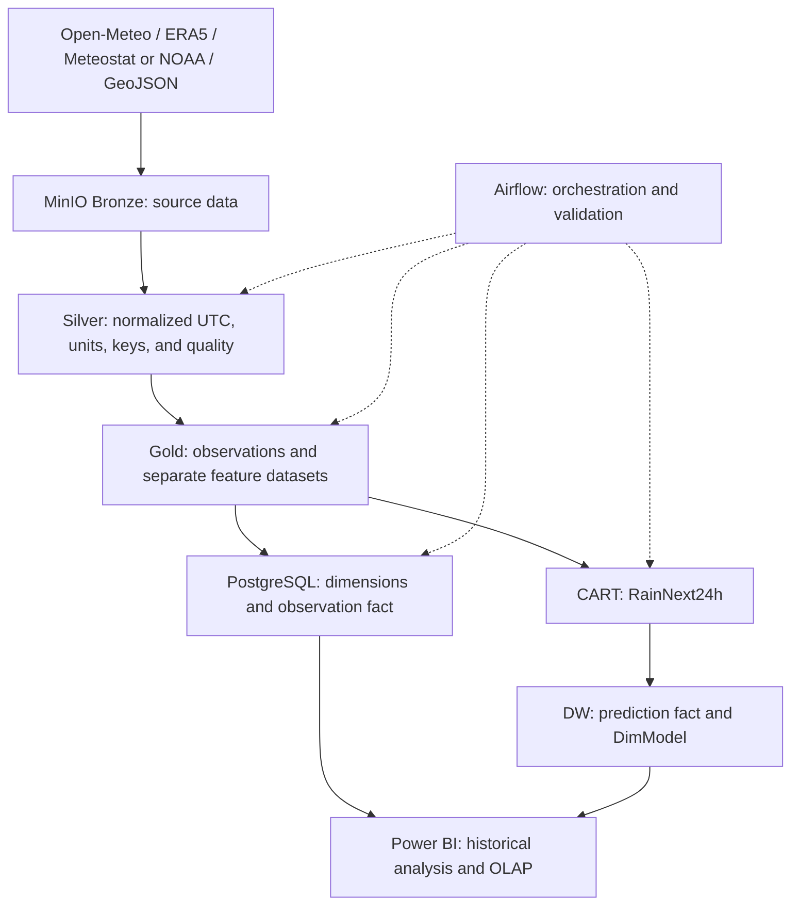

# System Architecture

This document describes the proposal's target architecture separately from the current implementation. Inventory date: 2026-10-08. See [progress](progress.md) for verification evidence and outstanding work.

## Target workflow

Observations retain separate sources. Gold for DW and Gold for ML have different grains; source pivots for ML do not change the observation fact grain.

## Components and current implementation

| Component | Target | Repository evidence |
| --- | --- | --- |
| Docker Compose | MinIO, PostgreSQL, Airflow | Configuration exists; runtime was not checked during the inventory |
| Open-Meteo | Hourly data, 2016–2025, eight points | Annual download script and manually triggered split-based DAG |
| ERA5, stations, boundaries | Real NetCDF, CSV/Text, GeoJSON sources | No real collectors/transformations found; synthetic test fixtures exist |
| Bronze/Silver/Gold | Contracted data layers | Bucket initialization and temporary Bronze pytest uploads; no real Silver/Gold ETL |
| DW | Dimensions, facts, loading, and OLAP | Initialization DDL and seeds; no loader/OLAP views |
| ML and BI | CART, predictions in DW, dashboards | No model or Power BI artifacts found |

## Runtime and connections

- Compose uses PostgreSQL 16. Airflow services share a `Dockerfile` build with Airflow 2.9.3/Python 3.10 and local image `weather-airflow:2.9.3-python3.10`.
- Python dependencies are locked in `requirements.txt` and installed during builds with hashes and `pip check`; `_PIP_ADDITIONAL_REQUIREMENTS` has been removed. See [development](development.md) for setup/lock updates and [progress](progress.md) for actual build results.
- Inside Docker: MinIO `minio:9000`, PostgreSQL `postgres:5432`. Host defaults: `localhost:9000` and `localhost:5434`; ports are configurable.
- The PostgreSQL initializer uses the fixed database name `weather_dwh`. Supporting another name requires a separate change and verification.
- `weather_system_healthcheck_dag` runs daily. `open_meteo_ingest_to_bronze_dag` is manual, not an incremental pipeline.
- Main Compose builds target `runtime`; target `test` adds pytest and fixtures. The independent `docker-compose.test.yml` stack uses PostgreSQL/MinIO on tmpfs, an internal network, and no development-data mounts. CI uses the same Makefile as local checks.

## Documents and ownership

- [Data contract](data-contract.md): schema, UTC, units, and data handling.
- [Naming conventions](NAMING_CONVENTIONS.md): buckets, keys, and partitions.
- [Warehouse schema](warehouse-schema.md): grain, keys, relationships, and OLAP.
- [Rain label](rain-label.md): labels and evaluation methodology.
- [Progress](progress.md): actual results and limitations.

The allocation workbook owns assignments: N1 ETL/infrastructure, N2 DW/BI, N3 ERA5/ML. Contract and label decisions belong to the whole team. Do not replace member codes with assumed personal names.
