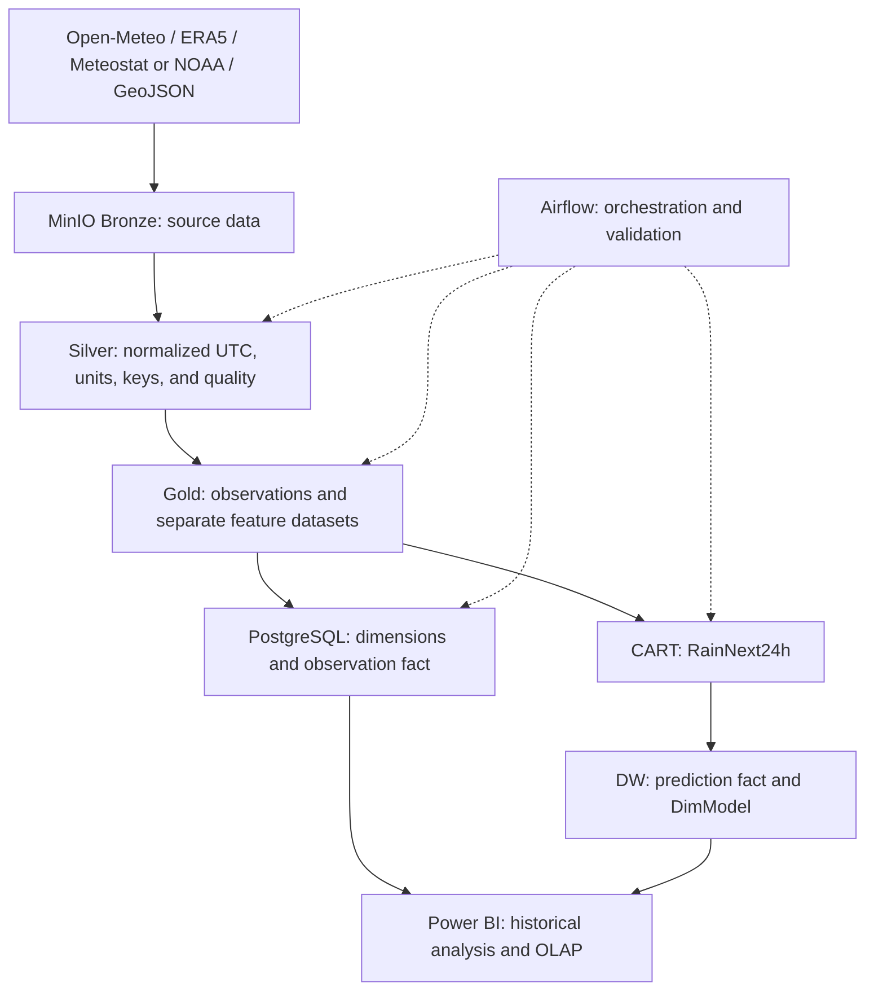

# System Architecture

This document describes the proposal's target architecture separately from the current implementation. First inventory: 2026-10-08; component status updated 2026-10-21. See [progress](progress.md) for verification evidence and outstanding work.

## Target workflow

Observations retain separate sources. Gold for DW and Gold for ML have different grains; source pivots for ML do not change the observation fact grain.

## Components and current implementation

Status as of 2026-10-22; [progress](progress.md) holds the commands, row counts, and limits behind each row.

| Component | Target | Repository evidence |
| --- | --- | --- |
| Docker Compose | MinIO, PostgreSQL, Airflow | Runs locally; build and integration tests pass; Airflow webserver, scheduler, and DAG runs verified end-to-end on 2026-10-22 (ID 1) |
| Open-Meteo | Hourly data, 2016–2025, eight points | Annual download script (received bytes plus manifest), the Bronze-only DAG, and the full pipeline DAG (ID 17); full 10-year Bronze → Silver → Gold → DW run on one local machine |
| Stations | Meteostat hourly and NOAA GHCNh daily rainfall | Verified station registry (`scripts/station_config.py`). Meteostat: script ETL into the observation fact, model-derived values removed; only Hà Nội is mapped and it reports no rainfall. GHCNh: five stations into `fact_station_daily_rain` |
| ERA5 | Real NetCDF | `scripts/ingest_era5_timeseries.py`: point time series for the 8 locations, 2016–2025, in Bronze with manifests (2026-10-23); `scripts/transform_era5_to_silver.py`: Silver hourly (701,376 rows, ID 15); `scripts/compare_era5_open_meteo.py`: comparison with Open-Meteo. `scripts/ingest_era5.py` (gridded monthly requests) has 2016-01/02 and 2024-01/02 (stopped 2026-10-23). ERA5 is loaded into the DW by the Gold loader and is part of the pipeline DAG since 2026-10-23 |
| Boundaries | 63-province (pre-merger) GeoJSON | `scripts/ingest_boundaries.py`: geoBoundaries VNM ADM1 (commit `9469f09`) in Bronze with a manifest; 25 northern provinces in Silver; research points checked (ID 4) |
| Bronze/Silver/Gold | Contracted data layers | Script-based ETL for all three layers. Bronze keeps received bytes with manifests for Open-Meteo, GHCNh, ERA5, and boundaries; Meteostat Bronze is still the decompressed CSV without a manifest (ID 9). Silver verifies Open-Meteo manifest checksums |
| DW | Dimensions, facts, loading, and OLAP | DDL, seeds, idempotent loaders, OLAP views (`sql/02_olap_views.sql`, `sql/03_station_daily_rain.sql`); DAG `weather_bronze_to_dw_dag` (ID 17) runs Open-Meteo, Meteostat, and GHCNh Bronze → Silver → (Gold) → DW for an explicit window of years, stops before any DW write when the Silver quality gate fails (`scripts/quality_gate.py`, ID 24), and reconciles both facts with Silver (`scripts/reconcile_dw.py`); verified on 2016–2025; manual trigger, no incremental schedule (ID 25) |
| ML | CART, predictions in DW | RainNext24h labels, feature datasets v1 (used by model v1) and v2 (corrected labels, current), and CART model v1 (tuned on validation 2024, evaluated once on test 2025) in Gold ML, plus EDA and tree/rules notebooks; test 2025 predictions loaded into `fact_weather_prediction` with `dim_model` (`sql/04_predictions.sql`); no scoring DAG (ID 32) |
| BI | Power BI dashboards | Build guide `docs/powerbi-dashboard-v1.md`; no PBIX file |

## Runtime and connections

- Compose uses PostgreSQL 16. Airflow services share a `Dockerfile` build with Airflow 2.9.3/Python 3.10 and local image `weather-airflow:2.9.3-python3.10`.
- Python dependencies are locked in `requirements.txt` and installed during builds with hashes and `pip check`; `_PIP_ADDITIONAL_REQUIREMENTS` has been removed. See [development](development.md) for setup/lock updates and [progress](progress.md) for actual build results.
- Inside Docker: MinIO `minio:9000`, PostgreSQL `postgres:5432`. Host defaults: `localhost:9000` and `localhost:5434`; ports are configurable.
- The PostgreSQL initializer uses the fixed database name `weather_dwh`. Supporting another name requires a separate change and verification.
- `weather_system_healthcheck_dag` runs daily. `open_meteo_ingest_to_bronze_dag` is manual, not an incremental pipeline.
- Main Compose builds target `runtime`; target `test` adds pytest and fixtures. The independent `docker-compose.test.yml` stack uses PostgreSQL/MinIO on tmpfs, an internal network, and no development-data mounts. CI uses the same Makefile as local checks.

## Documents and ownership

- [Data contract](data-contract.md): schema, UTC, units, and data handling.
- [Naming conventions](NAMING_CONVENTIONS.md): buckets, keys, and partitions.
- [Warehouse schema](warehouse-schema.md): grain, keys, relationships, and OLAP.
- [Rain label](rain-label.md): labels and evaluation methodology.
- [Progress](progress.md): actual results and limitations.

The allocation workbook owns assignments: N1 ETL/infrastructure, N2 DW/BI, N3 ERA5/ML. Contract and label decisions belong to the whole team. Do not replace member codes with assumed personal names.
