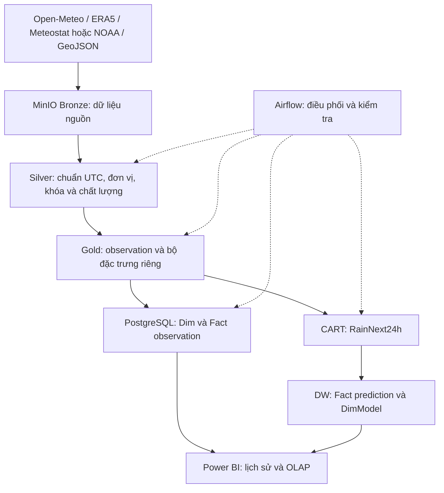

# Kiến trúc hệ thống

Tài liệu mô tả mục tiêu từ đề tài và phân biệt với triển khai hiện tại. Cập nhật kiểm kê: 08/10/2026; xem [tiến độ](progress.md) để biết bằng chứng và phần còn thiếu.

## Luồng mục tiêu

Observation giữ riêng từng nguồn. Gold phục vụ DW và Gold phục vụ ML có grain khác nhau; pivot nguồn cho ML không thay grain của Fact observation.

## Thành phần và triển khai hiện tại

| Thành phần | Mục tiêu | Bằng chứng trong repo |
| --- | --- | --- |
| Docker Compose | MinIO, PostgreSQL, Airflow | Có cấu hình; chưa kiểm tra runtime trong lượt kiểm kê |
| Open-Meteo | Dữ liệu giờ, 2016–2025, 8 điểm | Có script tải theo năm và DAG thủ công theo split |
| ERA5, trạm, địa giới | Nguồn NetCDF, CSV/Text, GeoJSON thực | Chưa tìm thấy bộ thu thập/biến đổi thực; có fixture kiểm thử giả lập |
| Bronze/Silver/Gold | Các tầng dữ liệu có hợp đồng | Có khởi tạo bucket và pytest upload Bronze tạm; chưa có ETL Silver/Gold thực |
| DW | Dim, Fact, nạp dữ liệu và OLAP | Có DDL khởi tạo và seed; chưa có loader/view OLAP |
| ML và BI | CART, dự báo vào DW, dashboard | Chưa tìm thấy artifact mô hình hoặc Power BI |

## Runtime và kết nối

- Compose dùng PostgreSQL 16; các service Airflow cùng build `Dockerfile` với Airflow 2.9.3/Python 3.10 và image local `weather-airflow:2.9.3-python3.10`.
- Dependency Python được khóa trong `requirements.txt` và cài khi build với kiểm tra hash/`pip check`; không còn `_PIP_ADDITIONAL_REQUIREMENTS`. Cách setup và cập nhật lock ở [môi trường phát triển](development.md); kết quả build thực tế ở [tiến độ](progress.md).
- Trong Docker: MinIO `minio:9000`, PostgreSQL `postgres:5432`. Từ host: mặc định `localhost:9000` và `localhost:5434`; cổng có thể đổi qua cấu hình.
- Script init PostgreSQL thực tế dùng tên `weather_dwh` cố định. Cần sửa và kiểm chứng riêng nếu muốn hỗ trợ tên database khác.
- `weather_system_healthcheck_dag` chạy hằng ngày; `open_meteo_ingest_to_bronze_dag` chạy thủ công, chưa phải incremental pipeline.
- Compose chính build target `runtime`; target `test` thêm pytest và fixture. Môi trường test độc lập trong `docker-compose.test.yml` dùng PostgreSQL/MinIO trên tmpfs, network nội bộ và không mount dữ liệu phát triển. CI gọi cùng Makefile như local.

## Tài liệu và quyền sở hữu

- [Data contract](data-contract.md): schema, UTC, đơn vị và xử lý dữ liệu.
- [Naming conventions](NAMING_CONVENTIONS.md): bucket, key và phân vùng.
- [Warehouse schema](warehouse-schema.md): grain, khóa, quan hệ và OLAP.
- [Rain label](rain-label.md): nhãn và phương pháp đánh giá.
- [Progress](progress.md): kết quả thực tế và hạn chế.

Workbook phân công vẫn là nơi quản lý người phụ trách: N1 ETL/hạ tầng, N2 DW/BI, N3 ERA5/ML; các quyết định hợp đồng và nhãn thuộc cả nhóm. Không tự đổi mã người thành tên cụ thể.
