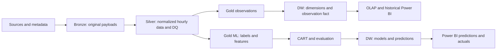

# Weather Data Platform: Business Requirements

Version 0.2, 2026-10-22 (0.1: 2026-10-10). This document translates the proposal and task allocation into business workflows and acceptance criteria for incremental implementation. Additional technical acceptance criteria are implementation proposals. Open decisions must be recorded in the relevant domain contract before use.

## 1. Sources and authority

| Source | Authority | Reviewed location |
| --- | --- | --- |
| [Project proposal](<../đề tài.pdf>) | Objectives, scope, technology, and final deliverables | Pages 1–7; architecture diagram on page 4 |
| [Task allocation workbook](../Phan_cong_cong_viec_DW_khi_tuong.xlsx) | Task IDs, weeks, owners, support, and outputs | `Theo dõi công việc!A5:O44`, `Vai trò!A3:D9`, `Rủi ro!A3:F13` |
| [Data contract](data-contract.md) | Columns, grain, UTC, units, missing/duplicate data, and provenance | Distinguishes established conventions from proposals |
| [Warehouse schema](warehouse-schema.md) | Keys, calendars, loading, and aggregation rules | Distinguishes existing DDL from required migrations |
| [Rain label](rain-label.md) | Labels, features, splits, and CART evaluation | Records label decisions and the items still open |
| [Naming conventions](NAMING_CONVENTIONS.md) | Buckets, object keys, and partitions | Documents actual and target paths |
| [Progress](progress.md) | Implementation and verification evidence | Determines what has actually been completed |
| [Task specifications, weeks 2–5](task-specs-weeks-2-5.md) | Proposed business specifications for IDs 19, 20, 9, 17, 8, 4, 5 | Proposals until confirmed in the owning document |

The workbook contains 40 tasks across 10 weeks. N1 covers infrastructure/ETL, N2 covers DW/BI, and N3 covers ERA5/ML. Read current owners and support assignments from the workbook when executing a task; this document does not maintain a second assignment or percentage tracker. Week 1 currently starts on **2026-10-12** in `Tổng quan!E11`. The workbook labels this as an editable assumption, not a confirmed deadline.

## 2. Objectives and scope

The system serves two business needs: analyze historical weather by time, location, and source; classify rain occurrence within the next 24 hours using CART and show predictions alongside actual weather in Power BI.

| Requirement | Source | Implementation interpretation |
| --- | --- | --- |
| Multiple sources and formats | PDF section 5, pages 2–3 | Open-Meteo/JSON, ERA5 or ERA5-Land/NetCDF, Meteostat or NOAA/CSV-Text, boundaries/GeoJSON |
| Northern Vietnam, hourly data, approximately 10 years | PDF section 4, page 2; section 12, page 5; workbook ID 8 | PDF proposes 6–10 points; workbook and code specify 8 points and 2016–2025 |
| Three-layer Data Lake | PDF section 7, page 4 | Bronze preserves source data; Silver normalizes it; Gold serves DW and ML |
| Python/Airflow ETL | PDF section 8, page 5 | Traceable ingestion, normalization, validation, publication, and DW loading |
| PostgreSQL Star Schema | PDF section 9, page 5 | Observation grain is source × location × hour; five dimensions and the observation fact |
| Power BI and OLAP | PDF section 10, page 5 | Trends, comparisons, rainy/hot days, maps; Roll-up, Drill-down, Slice, Dice |
| CART RainNext24h | PDF sections 11–12, page 5 | Yes/No; train 2016–2023, validation 2024, test 2025; emphasize Recall and report all required metrics |
| Predictions integrated into DW/BI | PDF section 13, page 6; IDs 31–33 | Probability, class, model version, and target windows that can be reconciled |
| Final handover | PDF section 15, page 7; IDs 37–40 | Data, ETL, DW, dashboards, model, evaluation report, slides, and demo |

Preserve research location codes `HAN`, `PTO`, `TNG`, `TUQ`, `LCA`, `HBI`, `HPH`, and `NBI`. Research locations are stable coordinate points. Province names and boundaries may change and require versioned mapping. The workbook (IDs 4/11, risk sheet row 9) asks for boundaries effective after 2025-07-01 and old + new names; on 2026-10-21 the N2 owner of IDs 4/11 decided to use pre-merger (63-province) boundaries instead (see §6 and [task specs §7](task-specs-weeks-2-5.md#7-id-4--real-boundary-geojson-n2-week-1-backlog)). Verify the actual source, license, effective date, and geometry when acquiring the data. A filename or synthetic Point fixture is not evidence of correct boundaries.

Keep MinIO, Airflow, Python, PostgreSQL, scikit-learn, and Power BI. PDF section 14 does not target Hadoop/Spark/Kubernetes unless scale requires them.

## 3. Business workflow and exchange products

PDF page 4 places Data Mining downstream of the DW. Gold ML in the repository architecture is a separate training exchange product. It may be exported from Silver/Gold or the DW under an agreed contract, must reconcile with normalized observations, and must retain lineage. ML pivots must not change the observation fact grain.

| Business step | Inputs → outputs | Proposed acceptance criteria |
| --- | --- | --- |
| Ingestion | Request/scope → raw files and Bronze manifests | Record source, window, coordinates, checksum, retrieval time, and per-part status; exclude secrets from manifests |
| Normalization | Raw data and metadata → Silver Parquet | Timezone-aware UTC, verified units/interval semantics, stable keys, correct null meaning, lineage, and DQ results |
| Observation preparation | Silver → Gold observations | Preserve separate sources, resolve station multiplicity, and satisfy grain and loader contracts |
| DW loading | Gold and dimensions → facts | Load dimensions first; complete lookups, transactional upserts, duplicate prevention, and verified reruns |
| Historical analysis | DW → OLAP/measures/dashboard | Apply variable/source-specific aggregation, disclose coverage, and match SQL under identical filters |
| ML preparation | Normalized history → labeled feature dataset | Complete ground-truth windows, no leakage, chronological splits, and purged labels crossing split boundaries |
| Training/evaluation | Train/validation/test → artifacts and metrics | Select hyperparameters and threshold on validation; evaluate test after freezing the design; Rain is the positive class |
| Prediction integration | Artifact and features at origin → DW/BI predictions | UTC origin/target, horizon, model/label version, threshold, probability/class, and duplicate-free reruns |

Passing a small-window test establishes technical acceptance only for that window. IDs 8/18 require a separate coverage report for the full 10-year output. Unit tests, schema creation, or sample uploads cannot establish that coverage.

## 4. Cross-cutting rules

- Canonical time is timezone-aware UTC. Derive Vietnam local time for display. Decide date/time key calendar basis before implementing loaders and daily aggregates.
- Observations retain one source × one point × one hour. Station selection/aggregation requires an explicit rule and provenance; it must not silently expand the grain.
- Missing rain differs from zero rain. An absent record differs from a record with null values. Do not fill missing labels with No or use future information to impute features.
- Sum rain over nonoverlapping intervals for the same source/location. Do not sum sources into actual rainfall. Means require valid counts; wind direction needs circular/vector aggregation.
- Products need traceable manifests, scope, and versions. Task failures must surface as failures. Advance watermarks only after successful publication/commit.
- Label, split, and evaluation rules are owned by [rain-label.md](rain-label.md). The rainfall threshold defining ground truth differs from the probability threshold defining predicted classes.
- Write new or changed code and documentation in English. Code includes identifiers, comments, docstrings, logs, errors, and CLI help. Preserve proper place names, source payloads, workbook sheet names, stable IDs, and existing business values. Language edits must not alter schemas or payload contracts.

## 5. Decisions to resolve

| Decision | Related IDs | Owning document | Dependent work |
| --- | --- | --- | --- |
| Station source and ERA5/ERA5-Land product | 5, 9, 14–15 | Data contract | Adapters, units, latency, and accumulation |
| Interval semantics and pressure/radiation mapping | 6, 10, 15 | Data contract | Silver, totals, features, and labels |
| Conflicting duplicates, coverage, and imputation | 6, 10, 15, 24 | Data contract | DQ and publication gates |
| Station selection/distance/namespace and province mapping | 4, 11 | Warehouse schema and data contract | DimLocation/Station and grain |
| Calendar basis, weekdays, rainy season, and hot days | 3, 12, 19, 27 | Warehouse schema | DimDate, OLAP, and BI |
| Label source, rainfall threshold, fallback, and 24-hour completeness | 7, 22 | Rain label | Dataset and ground truth |
| ML source policy and lineage | 16, 23 | Data contract and rain label | Pivot/fusion and feature availability |
| Prediction key/window and model/label metadata | 31–33 | Warehouse schema and rain label | Prediction loader and forecast page |
| Recall/false-alarm targets, latency, and performance | 26, 28–29, 36 | Warehouse schema or rain label as applicable | Benchmarks and quantitative acceptance |

AI may propose options and implement independent authorized work, but must not promote an open decision to an approved requirement. Pause only the dependent work and continue independent work within the assigned scope.

Status on 2026-10-22: the label threshold (1 mm over `(t, t+24h]`), the Open-Meteo label source for the first experiment, the missing-hour rule, and the UTC+7 calendar basis were decided on 2026-10-21 by the N1/N2 member with the team's confirmation relayed verbally (see [rain-label.md](rain-label.md) and [data-contract.md](data-contract.md)). Station-first/ERA5 fallback for labels, minimum coverage, the Recall target, and N3's review of the ML decisions remain open (§5a).

## 5a. Proposals awaiting team decision (2026-10-22)

These came from the 2026-10-22 audit. On 2026-10-22 the N1/N2 member doing N3's ML work accepted the first two; N3 has not reviewed them yet, so they stay marked as such until N3 confirms.

| Item | Current state | Proposal | Needs |
| --- | --- | --- | --- |
| Recall emphasis (PDF §12) | **Decided 2026-10-22 (N1/N2 for N3; N3 review pending).** CART v1 chose its configuration and threshold by maximum validation F1 (0.40) | Recall operating point = the threshold with the highest validation precision among those with validation recall ≥ 0.85. For CART v1 on corrected validation labels: 0.36 (precision 0.710, recall 0.880, F1 0.786) versus 0.40 (0.760, 0.819, 0.789). The 0.85 target was set after viewing the validation scan. 0.40 stays the official one-time test result; test metrics at 0.36 are reported in ID 36 as post-hoc. Later models apply the rule on validation before test | N3 review |
| ERA5/NetCDF and GeoJSON (IDs 4, 5, 14, 15) | **Plan accepted 2026-10-22; data complete 2026-10-23.** ID 4 done (GeoJSON in Bronze/Silver). IDs 5/14: CDS account, licence, and requests done; the ERA5 point time series for the 8 locations, 2016–2025, is in Bronze as NetCDF with manifests (decided 2026-10-23 because gridded monthly requests wait about two hours each); gridded months 2016-01/02 and 2024-01/02 are also stored. ID 15: Silver hourly ERA5 implemented (701,376 rows) with a comparison to Open-Meteo. The NetCDF part of the multi-format objective (PDF §5) is met. Open: whether ERA5 is loaded into the DW | ID 4 GeoJSON (63 provinces, task specs §7) done on 2026-10-22. ID 5: N3 creates the CDS account and accepts the licences; request ERA5 hourly single levels for 19.5–23.5°N, 102.0–107.5°E (area `[23.5, 102.0, 19.5, 107.5]`; unified on 2026-10-22 from the two slightly different boxes in task specs §8 and an earlier version of this row): `2m_temperature`, `2m_dewpoint_temperature`, `total_precipitation`, `surface_pressure`, `10m_u_component_of_wind`, `10m_v_component_of_wind`, `total_cloud_cover`, 2016–2025, NetCDF, split into requests that fit the CDS limits (not yet verified). ERA5 hourly `tp` is a per-hour accumulation (no deaccumulation, unlike ERA5-Land). ERA5 is for cross-source comparison and the NetCDF requirement; it does not replace the label source of model v1. Fallback: N1 does IDs 14/15, or the scope narrows to 2024–2025 and the report says so. `scripts/ingest_era5.py` (Bronze, IDs 5/14) is ready and tested on synthetic NetCDF; it needs the CDS URL and key in `.env` | Done 2026-10-22 (the user): account, licence, go-ahead. Open: ERA5 Silver (ID 15) and whether ERA5 is loaded into the DW |
| N3 review of ML decisions | Labels (1 mm, Open-Meteo), features v1/v2, the selection and threshold rules, the Recall operating point, the corrected-label re-score, and the CART v1 interpretation were decided by the N1/N2 member for N3 (recorded "Do N1/N2 làm thay N3") | N3 works through the checklist in [rain-label.md](rain-label.md#review-by-n3-pending) | N3 |

## 6. Discrepancies to preserve explicitly

| Source/current behavior | Implementation interpretation |
| --- | --- |
| ID 29 mentions threshold adjustment during test 2025; risk sheet row 12 specifies adjustment on 2024 | Choose the threshold on validation 2024 and freeze it before test 2025, consistent with the split methodology and rain label. The workbook was not edited |
| ID 36 compares thresholds in week 9 | Select thresholds on validation. If reporting predeclared thresholds on test, disclose the analysis; do not select a new model from test results and claim independent testing |
| Risk sheet row 5 describes ERA5-Land accumulation | Verify metadata for the actual product; do not apply identical deaccumulation to every ERA5/ERA5-Land file |
| ID 16 merges/pivots sources for ML; PDF requires source-specific observations | Separate Gold observations and Gold ML; pivots must not erase DW source identity or sum rainfall across sources |
| Ingestion modifies payloads, skips by size, and can mask failures | Fixed for Open-Meteo on 2026-10-22: failures exit 1, Bronze keeps the received bytes with a manifest, and skips use the manifest checksum and coverage (all 80 objects replaced by identical originals). Meteostat Bronze still stores the decompressed CSV without a manifest (ID 9) |
| Base and local tests pass; workbook tasks still say Chưa bắt đầu | Workbook management status has not been updated automatically. Do not mark all 40 tasks or all of week 1 complete |
| Workbook IDs 4/11 and risk row 9 originally asked for post-merger boundaries and old + new names | Decided 2026-10-21 by the N2 owner of IDs 4/11: pre-merger (63-province) boundaries only; `dim_location.province` keeps pre-merger names; no mapping table. On 2026-10-22 the workbook texts (ID 4 and ID 11 descriptions, risk row 9 handling) were rewritten to the decided scope, each quoting the original wording |
| PDF §12 asks to emphasize Recall; CART v1 maximizes F1 | Disclosed in [rain-label.md](rain-label.md); a predeclared Recall rule is proposed for ID 36 (§5a) |
| PDF §5 lists NetCDF and GeoJSON | Open-Meteo JSON, Meteostat CSV, GHCNh PSV, and boundary GeoJSON (ID 4, 2026-10-22) are implemented; ERA5 NetCDF is planned (§5a) |
| Meteostat 48820 "Ha Noi" is mapped to HAN, but its hourly values come from Nội Bài airport (ISD 488200, METAR VVNB), about 22 km from the HAN point | Recorded as `nearest_available` with the airport coordinates since 2026-10-22; station-versus-grid comparisons for HAN compare the airport with the HAN grid point |
| ID 11 asks for GeoPandas distance assignment | Distances are computed once (haversine) and stored in `scripts/station_config.py`; values were recomputed in the 2026-10-22 audit (HAN 22.0 km for Meteostat, 11.3 km for GHCNh Hà Đông) |

## 7. Handover criteria

Deliver the nine products listed in PDF section 15. Each product needs scope, version, reproduction instructions, source/lineage, actual checks, and remaining limits. Dashboards require real Power BI artifacts. Models require real artifacts, ordered features, preprocessing, and evaluation metrics. Do not fabricate `.pbix` files or report CART library smoke tests as forecast accuracy.

Follow the [implementation roadmap](implementation-roadmap.md), read actual status from [progress](progress.md), and record evidence after each coding task.
