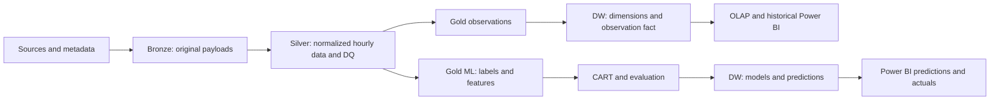

# Weather Data Platform: Business Requirements

Version 0.1, 2026-10-10. This document translates the proposal and task allocation into business workflows and acceptance criteria for incremental implementation. Additional technical acceptance criteria are implementation proposals. Open decisions must be recorded in the relevant domain contract before use.

## 1. Sources and authority

| Source | Authority | Reviewed location |
| --- | --- | --- |
| [Project proposal](<../đề tài.pdf>) | Objectives, scope, technology, and final deliverables | Pages 1–7; architecture diagram on page 4 |
| [Task allocation workbook](../Phan_cong_cong_viec_DW_khi_tuong.xlsx) | Task IDs, weeks, owners, support, and outputs | `Theo dõi công việc!A5:O44`, `Vai trò!A3:D9`, `Rủi ro!A3:F13` |
| [Data contract](data-contract.md) | Columns, grain, UTC, units, missing/duplicate data, and provenance | Distinguishes established conventions from proposals |
| [Warehouse schema](warehouse-schema.md) | Keys, calendars, loading, and aggregation rules | Distinguishes existing DDL from required migrations |
| [Rain label](rain-label.md) | Labels, features, splits, and CART evaluation | Identifies unresolved label decisions |
| [Naming conventions](NAMING_CONVENTIONS.md) | Buckets, object keys, and partitions | Documents actual and target paths |
| [Progress](progress.md) | Implementation and verification evidence | Determines what has actually been completed |

The workbook contains 40 tasks across 10 weeks. N1 covers infrastructure/ETL, N2 covers DW/BI, and N3 covers ERA5/ML. Read current owners and support assignments from the workbook when executing a task; this document does not maintain a second assignment or percentage tracker. Week 1 currently starts on **2026-10-12** in `Tổng quan!E11`. The workbook labels this as an editable assumption, not a confirmed deadline.

## 2. Objectives and scope

The system serves two business needs: analyze historical weather by time, location, and source; classify rain occurrence within the next 24 hours using CART and show predictions alongside actual weather in Power BI.

| Requirement | Source | Implementation interpretation |
| --- | --- | --- |
| Multiple sources and formats | PDF section 5, pages 2–3 | Open-Meteo/JSON, ERA5 or ERA5-Land/NetCDF, Meteostat or NOAA/CSV-Text, boundaries/GeoJSON |
| Northern Vietnam, hourly data, approximately 10 years | PDF section 4, page 2; section 12, page 5; workbook ID 8 | PDF proposes 6–10 points; workbook and code specify 8 points and 2016–2025 |
| Three-layer Data Lake | PDF section 7, page 4 | Bronze preserves source data; Silver normalizes it; Gold serves DW and ML |
| Python/Airflow ETL | PDF section 8, page 5 | Traceable ingestion, normalization, validation, publication, and DW loading |
| PostgreSQL Star Schema | PDF section 9, page 5 | Observation grain is source × location × hour; five dimensions and the observation fact |
| Power BI and OLAP | PDF section 10, page 5 | Trends, comparisons, rainy/hot days, maps; Roll-up, Drill-down, Slice, Dice |
| CART RainNext24h | PDF sections 11–12, page 5 | Yes/No; train 2016–2023, validation 2024, test 2025; emphasize Recall and report all required metrics |
| Predictions integrated into DW/BI | PDF section 13, page 6; IDs 31–33 | Probability, class, model version, and target windows that can be reconciled |
| Final handover | PDF section 15, page 7; IDs 37–40 | Data, ETL, DW, dashboards, model, evaluation report, slides, and demo |

Preserve research location codes `HAN`, `PTO`, `TNG`, `TUQ`, `LCA`, `HBI`, `HPH`, and `NBI`. Research locations are stable coordinate points. Province names and boundaries may change and require versioned mapping. Boundaries effective after 2025-07-01 are a workbook requirement in IDs 4/11; verify the actual source, license, effective date, and geometry when acquiring the data. A filename or synthetic Point fixture is not evidence of correct boundaries.

Keep MinIO, Airflow, Python, PostgreSQL, scikit-learn, and Power BI. PDF section 14 does not target Hadoop/Spark/Kubernetes unless scale requires them.

## 3. Business workflow and exchange products

PDF page 4 places Data Mining downstream of the DW. Gold ML in the repository architecture is a separate training exchange product. It may be exported from Silver/Gold or the DW under an agreed contract, must reconcile with normalized observations, and must retain lineage. ML pivots must not change the observation fact grain.

| Business step | Inputs → outputs | Proposed acceptance criteria |
| --- | --- | --- |
| Ingestion | Request/scope → raw files and Bronze manifests | Record source, window, coordinates, checksum, retrieval time, and per-part status; exclude secrets from manifests |
| Normalization | Raw data and metadata → Silver Parquet | Timezone-aware UTC, verified units/interval semantics, stable keys, correct null meaning, lineage, and DQ results |
| Observation preparation | Silver → Gold observations | Preserve separate sources, resolve station multiplicity, and satisfy grain and loader contracts |
| DW loading | Gold and dimensions → facts | Load dimensions first; complete lookups, transactional upserts, duplicate prevention, and verified reruns |
| Historical analysis | DW → OLAP/measures/dashboard | Apply variable/source-specific aggregation, disclose coverage, and match SQL under identical filters |
| ML preparation | Normalized history → labeled feature dataset | Complete ground-truth windows, no leakage, chronological splits, and purged labels crossing split boundaries |
| Training/evaluation | Train/validation/test → artifacts and metrics | Select hyperparameters and threshold on validation; evaluate test after freezing the design; Rain is the positive class |
| Prediction integration | Artifact and features at origin → DW/BI predictions | UTC origin/target, horizon, model/label version, threshold, probability/class, and duplicate-free reruns |

Passing a small-window test establishes technical acceptance only for that window. IDs 8/18 require a separate coverage report for the full 10-year output. Unit tests, schema creation, or sample uploads cannot establish that coverage.

## 4. Cross-cutting rules

- Canonical time is timezone-aware UTC. Derive Vietnam local time for display. Decide date/time key calendar basis before implementing loaders and daily aggregates.
- Observations retain one source × one point × one hour. Station selection/aggregation requires an explicit rule and provenance; it must not silently expand the grain.
- Missing rain differs from zero rain. An absent record differs from a record with null values. Do not fill missing labels with No or use future information to impute features.
- Sum rain over nonoverlapping intervals for the same source/location. Do not sum sources into actual rainfall. Means require valid counts; wind direction needs circular/vector aggregation.
- Products need traceable manifests, scope, and versions. Task failures must surface as failures. Advance watermarks only after successful publication/commit.
- Label, split, and evaluation rules are owned by [rain-label.md](rain-label.md). The rainfall threshold defining ground truth differs from the probability threshold defining predicted classes.
- Write new or changed code and documentation in English. Code includes identifiers, comments, docstrings, logs, errors, and CLI help. Preserve proper place names, source payloads, workbook sheet names, stable IDs, and existing business values. Language edits must not alter schemas or payload contracts.

## 5. Decisions to resolve

| Decision | Related IDs | Owning document | Dependent work |
| --- | --- | --- | --- |
| Station source and ERA5/ERA5-Land product | 5, 9, 14–15 | Data contract | Adapters, units, latency, and accumulation |
| Interval semantics and pressure/radiation mapping | 6, 10, 15 | Data contract | Silver, totals, features, and labels |
| Conflicting duplicates, coverage, and imputation | 6, 10, 15, 24 | Data contract | DQ and publication gates |
| Station selection/distance/namespace and province mapping | 4, 11 | Warehouse schema and data contract | DimLocation/Station and grain |
| Calendar basis, weekdays, rainy season, and hot days | 3, 12, 19, 27 | Warehouse schema | DimDate, OLAP, and BI |
| Label source, rainfall threshold, fallback, and 24-hour completeness | 7, 22 | Rain label | Dataset and ground truth |
| ML source policy and lineage | 16, 23 | Data contract and rain label | Pivot/fusion and feature availability |
| Prediction key/window and model/label metadata | 31–33 | Warehouse schema and rain label | Prediction loader and forecast page |
| Recall/false-alarm targets, latency, and performance | 26, 28–29, 36 | Warehouse schema or rain label as applicable | Benchmarks and quantitative acceptance |

AI may propose options and implement independent authorized work, but must not promote an open decision to an approved requirement. The 0.1 or 1 mm threshold, station-first fallback, and minimum coverage remain unresolved. Pause only the dependent work and continue independent work within the assigned scope.

## 6. Discrepancies to preserve explicitly

| Source/current behavior | Implementation interpretation |
| --- | --- |
| ID 29 mentions threshold adjustment during test 2025; risk sheet row 12 specifies adjustment on 2024 | Choose the threshold on validation 2024 and freeze it before test 2025, consistent with the split methodology and rain label. The workbook was not edited |
| ID 36 compares thresholds in week 9 | Select thresholds on validation. If reporting predeclared thresholds on test, disclose the analysis; do not select a new model from test results and claim independent testing |
| Risk sheet row 5 describes ERA5-Land accumulation | Verify metadata for the actual product; do not apply identical deaccumulation to every ERA5/ERA5-Land file |
| ID 16 merges/pivots sources for ML; PDF requires source-specific observations | Separate Gold observations and Gold ML; pivots must not erase DW source identity or sum rainfall across sources |
| Ingestion modifies payloads, skips by size, and can mask failures | These are implementation limitations, not target contracts; address them within IDs 8/17/24 |
| Base and local tests pass; workbook tasks still say Chưa bắt đầu | Workbook management status has not been updated automatically. Do not mark all 40 tasks or all of week 1 complete |

## 7. Handover criteria

Deliver the nine products listed in PDF section 15. Each product needs scope, version, reproduction instructions, source/lineage, actual checks, and remaining limits. Dashboards require real Power BI artifacts. Models require real artifacts, ordered features, preprocessing, and evaluation metrics. Do not fabricate `.pbix` files or report CART library smoke tests as forecast accuracy.

Follow the [implementation roadmap](implementation-roadmap.md), read actual status from [progress](progress.md), and record evidence after each coding task.
