# Star schema diagram

Generated on 2026-10-22 from the live `weather_dwh` catalog (`information_schema.columns`, primary keys, and `pg_constraint` foreign keys) after migrations `02`–`05`, so it shows the implemented schema, not a draft. It replaces the 2026-10-13 sketch that was kept only in the untracked `outputs/` folder. Regenerate it after any schema migration. Rules, grain, and open items are in [warehouse-schema.md](../warehouse-schema.md).

| Fact | Grain | Unique key |
| --- | --- | --- |
| `fact_weather_observation` | One source × one research location × one UTC hour | `(date_key, time_key, location_key, source_key)`; keys in Vietnam local time |
| `fact_weather_prediction` | One model version × one location × one UTC forecast origin | `(model_key, location_key, origin_utc)` |
| `fact_station_daily_rain` | One source × one station × one rain day `(D-1 12:00, D 12:00]` UTC | `(source_key, station_key, rain_day_utc)` |

Several roles of one dimension share a table: `fact_weather_prediction` references `dim_date` twice (origin date and target date). `dim_station.location_key` is the hourly Meteostat mapping and is NULL for stations used only for daily rain; `fact_station_daily_rain` carries its own `location_key`. `fact_weather_prediction.model_name`/`model_version` are legacy copies of `dim_model`.

```mermaid
erDiagram
    fact_weather_observation {
        bigint fact_id PK
        int date_key FK
        int time_key FK
        int location_key FK
        int source_key FK
        int station_key FK
        timestamptz timestamp_utc
        timestamp timestamp_local
        numeric temperature_c
        numeric humidity_percent
        numeric pressure_hpa
        numeric precipitation_mm
        numeric wind_speed_ms
        numeric wind_direction_deg
        numeric cloud_cover_percent
        numeric solar_radiation_wm2
        timestamp created_at
        varchar pressure_type
    }
    fact_weather_prediction {
        bigint prediction_id PK
        int prediction_date_key FK
        int prediction_time_key FK
        int target_date_key FK
        int location_key FK
        varchar model_name
        varchar model_version
        bool rain_next_24h
        numeric rain_probability
        timestamp predicted_at
        int model_key FK
        timestamptz origin_utc
        timestamptz target_start_utc
        timestamptz target_end_utc
        smallint horizon_hours
        numeric probability_threshold
        varchar evaluation_split
    }
    fact_station_daily_rain {
        bigint daily_rain_id PK
        int source_key FK
        int station_key FK
        int location_key FK
        date rain_day_utc
        timestamptz window_start_utc
        timestamptz window_end_utc
        numeric rain_24h_mm
        bool is_trace
        varchar station_role
        varchar quality_code
        varchar measurement_code
        varchar report_type
        varchar source_code
        timestamp created_at
    }
    dim_date {
        int date_key PK
        date full_date
        int day_of_week
        varchar day_name
        int day_of_month
        int month
        varchar month_name
        int quarter
        int year
        bool is_weekend
        bool is_rainy_season
    }
    dim_time {
        int time_key PK
        int hour_24
        int minute
        varchar period_of_day
    }
    dim_location {
        int location_key PK
        varchar location_code
        varchar location_name
        varchar province
        varchar region
        numeric latitude
        numeric longitude
        numeric elevation_m
    }
    dim_source {
        int source_key PK
        varchar source_name
        varchar source_type
        varchar data_format
        varchar update_frequency
    }
    dim_station {
        int station_key PK
        varchar station_id
        varchar station_name
        varchar wmo_id
        numeric latitude
        numeric longitude
        numeric elevation_m
        int location_key FK
        varchar station_role
        numeric distance_km
    }
    dim_model {
        int model_key PK
        varchar model_name
        varchar model_version
        text algorithm
        text label_version
        text label_source
        text feature_version
        text feature_source
        numeric label_threshold_mm
        numeric probability_threshold
        smallint horizon_hours
        timestamptz train_start_utc
        timestamptz train_end_utc
        jsonb hyperparameters
        text artifact_uri
        char artifact_sha256
        numeric validation_f1
        numeric test_precision
        numeric test_recall
        numeric test_f1
        text availability_note
        timestamptz created_at
        text evaluation_label_version
        numeric validation_f1_evaluation_labels
    }
    dim_location ||--o{ dim_station : "location_key"
    dim_date ||--o{ fact_weather_observation : "date_key"
    dim_location ||--o{ fact_weather_observation : "location_key"
    dim_source ||--o{ fact_weather_observation : "source_key"
    dim_station ||--o{ fact_weather_observation : "station_key"
    dim_time ||--o{ fact_weather_observation : "time_key"
    dim_location ||--o{ fact_weather_prediction : "location_key"
    dim_model ||--o{ fact_weather_prediction : "model_key"
    dim_date ||--o{ fact_weather_prediction : "prediction_date_key"
    dim_time ||--o{ fact_weather_prediction : "prediction_time_key"
    dim_date ||--o{ fact_weather_prediction : "target_date_key"
    dim_location ||--o{ fact_station_daily_rain : "location_key"
    dim_source ||--o{ fact_station_daily_rain : "source_key"
    dim_station ||--o{ fact_station_daily_rain : "station_key"
```

